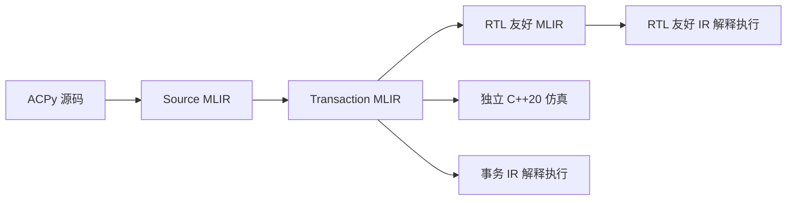

# pyCircuit

pyCircuit 用 Python 语法描述同步电路，通过 MLIR 编译为可逐拍执行的模型和独立 C++20 仿真程序。
前端语言称为 **ACPy**，中间表示称为 **ACIR**。设计者用 Module 组织电路、用 Rule 表达原子操作，
编译器负责传播就绪条件、检查组件契约、确定同拍顺序，并生成组合逻辑与下一拍状态。

项目目前聚焦于**可编译的电路描述、事务语义和多后端执行一致性**，已有数组仲裁、流水线 CPU、
OoO 调度器等示例。RTL 友好 IR 已能解释执行；SystemVerilog 后端及真正 RTL 仿真尚未实现。

## 里程碑：RV32IMC 五级 CPU 与原生 Ripes 对照

**2026-10-15**：完成 Ripes5 的 RV32IMC 整数指令模型及端到端验证，保留五级 Module、独立
HazardUnit／ForwardingUnit 和 Decode 内部 Signal。I、IM、IMC 共用一份模型，通过配置启用扩展。

| 项目 | 验证结果 |
| --- | --- |
| 完整程序 | 79 个不同程序，另有 10 项字段接口副本复测，共 89 项 |
| 原生参考对照 | 83 项严格一致，共 6,419 拍；4 条已知参考缺陷记录、2 项参考不支持单列 |
| 独立正确性 | 全部 89 项通过程序预期、生成 C++、两层 IR 解释及三个阶段独立重载检查 |
| 回归与边界 | 全仓 93 项编译器回归通过；24 项边界程序通过 C++ ASan／UBSan |
| 手写前端规模 | 717 行 ACPy，对比原生 CPU 的 21 个 C++ 头文件共 2,939 行，减少 **75.6%** |
| 编译器修复 | 支持 `fetch(control.stall, …)` 的字段依赖分析；完整 Control 的 IMC 生成头文件从 53,671 行降至 5,364 行，CPU 模型未因该修复改写 |

代码量统计为含注释及空行的物理行，双方均排除测试、运行器和通用框架。原生头文件还包含 RV64
分支与界面观察接口，因此该数字是明确文件范围内的文本规模比较。
已知参考差异不计作严格通过；独立预期检查 ISA 结果，避免仅凭两个实现一致判断正确。

同一混合循环汇编源的速度复测如下：预热 1,000 周期，计时 100,000 周期，重复五次取中位数，
生成 C++ 使用 `-O3`。计时排除编译、初始化和 trace，每次最终状态均与原生一致。

| 配置 | pyCircuit 生成 C++（周期/秒） | 原生 Ripes（周期/秒） | 相对速度 |
| --- | ---: | ---: | ---: |
| IM | **220,580** | 144,387 | **1.53 倍** |
| IMC | **191,108** | 141,287 | **1.35 倍** |

这些数据代表该混合循环。IM 速度低于历史记录，当前模型生成仍需约 41–45 秒，原因尚待进一步定位；
本里程碑不表示所有配置全面提速，也不表示已经完成 RTL 仿真。

详细口径、参考差异、源码清单和复现入口见 [Ripes5 报告](pycircuit/examples/ripes5/README.md)，
原始证据见[最终验收](pycircuit/examples/ripes5/results/field-analysis/final-verification.json)、
[速度测量](pycircuit/examples/ripes5/results/field-analysis/performance/summary.json)及
[代码量统计](pycircuit/examples/ripes5/results/field-analysis/source-size/summary.json)。

## 核心抽象

| 抽象 | 用途与语义 |
| --- | --- |
| Module | 静态实例、状态和接口；`__init__` 构造电路，`__call__` 表达固定连接和每拍调用路径 |
| Rule | 带参数、guard 和返回值的操作；实际执行路径上的状态效果全部成功或全部取消 |
| Cell | 保存跨拍状态；读取拍初值，获准写入在拍末提交 |
| Queue | 有限容量 FIFO；消费与写入受非空／容量条件约束，可利用同拍前序 pop 腾出的空间 |
| Signal | 本拍组合 data／valid；前序成功写入后可读，下拍重新失效 |
| EHR | 支持固定端口的同拍有序可见性；后序读取可观察规定端口之前的成功写入 |
| array | 固定形状的 payload、组件或 Module 数组；支持多维坐标、选取及显式仲裁 |

Module 主体中的修改性调用点形成独立事务，嵌套 Rule 调用归入外层原子事务；只读调用的条件沿
实际数据和控制依赖传播。某项读取未就绪时，依赖它的路径不能执行，也不能把失败当作 False 进入 else。
Rule 不会因为被声明就自动运行，同拍顺序也不由 Python 语句先后直接决定。

纯组合结构体可以用于信号分组。`consume(bundle.enable)` 按该字段追踪普通就绪条件，同时保留
显式 assert、Rule guard 和事务来源约束。无法消除的条件求值排序环使用有界按需生成；真正不合法的
依赖与调度仍报错。详见[字段分析](pycircuit/docs/field-projection.md)。

下面是最小的计数器写法。Module 由 ACPy 静态展开，方法参数不写 `self`：

```python
from pycircuit import ac

@ac.module
class Counter:
    def __init__() -> None:
        value = ac.cell[ac.u32](initial=0)

    @ac.rule
    def increment() -> None:
        value = value + 1

    def __call__() -> None:
        increment()
```

完整语义见[核心设计](pycircuit/docs/core-design.md)和 [ACPy 规范](acpy/spec.md)。

## 编译与执行流程



Python 前端解析并静态展开 Module，保存类型、实例、Rule 和结构化控制流。原生 C++／MLIR pass
完成事务提取、字段依赖和条件传播、契约检查、EHR 端口分配、静态调度及 RTL lowering。
C++ 后端从事务层生成代码；RTL 路径将逻辑资源展开为组合选择、使能和 current／next-state。

三个 MLIR 阶段均可独立保存和重载，无需重新读取 Python 源码。两层 IR 解释器和生成的 C++
分别执行后比较每拍 fire 与状态；程序示例另有独立预期。JSON 和 Graphviz 图用于观察和报告，
不作为后续编译输入。

## 快速上手

所有命令从仓库根目录运行。目前直接在源码目录使用 Python 模块，无需安装 Python 包。
依赖 Python 3.11、CMake 3.20+、Ninja、C++20 编译器和 LLVM／MLIR 开发环境。
已验证的本地组合为 Clang 22、GCC 14 sysroot 与 LLVM／MLIR 22.1.8；具体路径配置见
[构建说明](pycircuit/README.md#构建与测试)。Graphviz 仅用于渲染图，不是编译或执行依赖。

本地开发机使用 GCC 14 运行库，运行编译器及生成程序前设置如下；其他环境使用各自工具链的运行库路径：

```bash
export LD_LIBRARY_PATH=/home/lc/opt/gcc14/lib${LD_LIBRARY_PATH:+:$LD_LIBRARY_PATH}
```

### 构建工具

以下假定 LLVM／MLIR 已安装，将 `MLIR_DIR` 替换为实际路径，并使用与该安装兼容的 C++ 工具链：

```bash
cmake -S pycircuit -B pycircuit/builds/compiler -G Ninja \
  -DMLIR_DIR=/path/to/llvm/lib/cmake/mlir \
  -DCMAKE_BUILD_TYPE=Release
cmake --build pycircuit/builds/compiler -j 6

export ACPY_MLIR_COMPILER="$PWD/pycircuit/builds/compiler/mlir/acir-compile"
export ACPY_MLIR_OPT="$PWD/pycircuit/builds/compiler/mlir/acir-opt"
```

### 编译并运行一个小模型

使用仓库现有的 EHR 共享视图示例生成三层 IR、C++ 和八拍 IR 轨迹：

```bash
python -m pycircuit compile pycircuit/examples/ehr_shared.py --top EHRShared \
  --output pycircuit/builds/benchmarks/quickstart --emit-cpp --cycles 8

c++ -std=c++20 -O3 pycircuit/builds/benchmarks/quickstart/cpp/sim.cpp \
  -o pycircuit/builds/benchmarks/quickstart/cpp/sim
pycircuit/builds/benchmarks/quickstart/cpp/sim --cycles 8 \
  --trace pycircuit/builds/benchmarks/quickstart/cpp/trace.json
```

生成的 `model.hpp`、`runtime.hpp`、`sim.cpp` 可一起复制到其他 C++20 环境，执行时不依赖
Python 或 LLVM／MLIR。C++ 模型提供 `reset()`、`tick()` 和 `trace()`；不传 `--trace` 可关闭逐拍轨迹输出。

### 重载阶段文件

```bash
python -m pycircuit run pycircuit/builds/benchmarks/quickstart/model.transaction.mlir \
  --output pycircuit/builds/benchmarks/quickstart-reload --cycles 8
```

同样可以重载 `model.source.mlir` 或 `model.rtl.mlir`。`--stop-after source|transaction|rtl` 控制停止阶段，
`--config NAME=VALUE` 传入静态构造配置，`--no-opt` 关闭可选优化。
`--emit-cpp` 接受 ACPy、Source 或 Transaction 输入；RTL 层不能反推生成 C++。

| 主要产物 | 内容 |
| --- | --- |
| `model.source.mlir` | ACIR v9 源语义：静态实例、接口、Rule、控制流和契约 |
| `model.transaction.mlir` | fire 条件、共享计算、条件化效果、端口与固定调度 |
| `model.rtl.mlir` | 组合逻辑、资源展开和 current／next-state |
| `cpp/` | 独立 C++ 仿真源码及 lowering 诊断 |
| `transaction-trace.json`、`rtl-trace.json` | 逐拍 fire 和提交后的逻辑状态 |
| `rule-graph.json` | 事务、顺序及竞争报告，可转为 Graphviz 图 |

## 测试与结果复现

按修改范围选择回归；下面的定向测试、全仓测试和完整程序验收是不同入口。

```bash
# 前端及字段依赖的定向回归
python -m unittest pycircuit.tests.test_frontend pycircuit.tests.test_field_projection -v

# 全仓回归：可用此命令，或执行下方 CTest
python -m unittest discover -s pycircuit/tests -v
ctest --test-dir pycircuit/builds/compiler --output-on-failure
```

全仓回归包含原生 Ripes 相关用例，需要先准备参考源码及运行器。
生成 C++ 的测试编译器可通过 `CXX` 配置；sanitizer 需要对应运行库。
四个通用示例的优化开关、多后端、重载及 sanitizer 验收入口为 `python -m pycircuit.tests.run_acceptance`，
它也会更新相应示例的默认生成产物。测试执行时间和带 trace 的运行时间不作为仿真速度 benchmark。

Ripes5 从独立 `.S`／`.c` 或外部 ELF 启动完整 CPU，使用程序清单和统一检查器：

```bash
python -m pycircuit.examples.ripes5.tests.native.build
python -m pycircuit.examples.ripes5.tests list
python -m pycircuit.examples.ripes5.tests run --case compressed_calls --check all
python -m pycircuit.examples.ripes5.tests run --all --check all
```

该入口默认检查程序预期和原生 Ripes；`--check all` 另做两层 IR 解释及阶段重载。
CPU 测试目前在示例内组织，尚未迁移为 `@ac.system` 接口。
参考版本、程序准备、分项检查和性能复现见 [Ripes5 测试说明](pycircuit/examples/ripes5/tests/README.md)。

## 示例

| 示例 | 主要内容 | Top |
| --- | --- | --- |
| [EHR 共享视图](pycircuit/examples/ehr_shared.py) | 固定端口及同拍共享读取 | `EHRShared` |
| [数组仲裁](pycircuit/examples/array_arbiter.py) | Module 数组、多维 age matrix、选取和反压取消 | `ArrayArbiter` |
| [Queue 流水线 CPU](pycircuit/examples/riscv_pipeline/model.py) | RV32I 子集、Queue 连接与 scoreboard | `Pipeline` |
| [Ripes5](pycircuit/examples/ripes5/README.md) | RV32IMC 五级流水线及原生 RV5S 对照 | `Demo` |
| [OoO 调度器](pycircuit/examples/ooo_scheduler/model.py) | ROB、操作数等待、发射、广播和顺序退休 | `OutOfOrder` |

Ripes5 的可编译 Top 位于 [model/demo.py](pycircuit/examples/ripes5/model/demo.py)。
更多阅读顺序与验证说明见[示例索引](pycircuit/examples/README.md)，默认产物见[构建产物索引](pycircuit/builds/README.md)。

## 当前边界

- ACPy 是 Python 语法的静态电路描述子集；组件只能在构造阶段创建，循环必须能静态展开，接口类型显式声明。
- 当前按编译期固定顺序尝试事务；尚无自动仲裁、激活调度或跨拍计算缓存。端口竞争需要设计者显式处理。
- Rule 节点合并后的同拍顺序图必须无环，某些分支相关但整体可调度的设计仍会被保守拒绝。
- 尚无 SystemVerilog 后端或真正 RTL 仿真；RTL 友好 IR 的解释一致性不能替代综合与硬件验证。
- 已知前端负数 `%` 的常量折叠与运行时有符号余数存在差异，详见[使用说明](pycircuit/README.md)。
- Ripes5 的运行环境支持退出与确定性打印；不包含交互输入、文件、CSR、特权架构或 RV64。

## 文档与目录

| 入口 | 内容 |
| --- | --- |
| [构建与使用](pycircuit/README.md) | 本地工具链、CLI、独立 pass、C++ 生成及测试细节 |
| [核心抽象](pycircuit/docs/core-design.md) | Module、Rule、组件契约和同拍顺序 |
| [ACPy 规范](acpy/spec.md) | 前端语法、类型、固定连接和合法表达 |
| [ACIR v9](pycircuit/acir.md) | Source、Transaction 和 RTL 三层 IR |
| [编译意图](pycircuit/docs/compiler-intent.md) | 各阶段应保留的语义 |
| [array 设计](pycircuit/docs/array-design.md) | 多维构造、选取与显式仲裁 |
| [字段依赖与条件生成](pycircuit/docs/field-projection.md) | 字段精度、必要约束和有界回退 |
| [历史路线图](pycircuit/docs/compiler-roadmap.md) | 编译器演进与各阶段证据；旧测试数量按当时版本保留 |

| 目录 | 用途 |
| --- | --- |
| `acpy/`、`acir/` | 语言规范与设计材料；当前 ACIR 规范入口为上表的 `pycircuit/acir.md` |
| `pycircuit/frontend.py`、`pycircuit/mlir_text.py` | ACPy 前端与 MLIR 序列化 |
| `pycircuit/mlir/` | 原生 MLIR dialect、pass、解释器和 C++ 后端 |
| `pycircuit/examples/`、`pycircuit/tests/` | 示例与通用回归 |
| `reference/<项目名>/` | 本地外部参考源码，不纳入 Git |
| `pycircuit/builds/compiler/` | 原生编译器构建 |
| `pycircuit/builds/<例子名>/` | 可审阅的默认生成产物 |
| `pycircuit/builds/benchmarks/` | benchmark 输入、实验、日志和结果 |

历史测量保留原路径；新参考源码、构建及实验统一使用上述目录。
示例 `results/` 以相对链接集中访问原始证据，部分构建和测量文件仅存在于本地工作目录。
