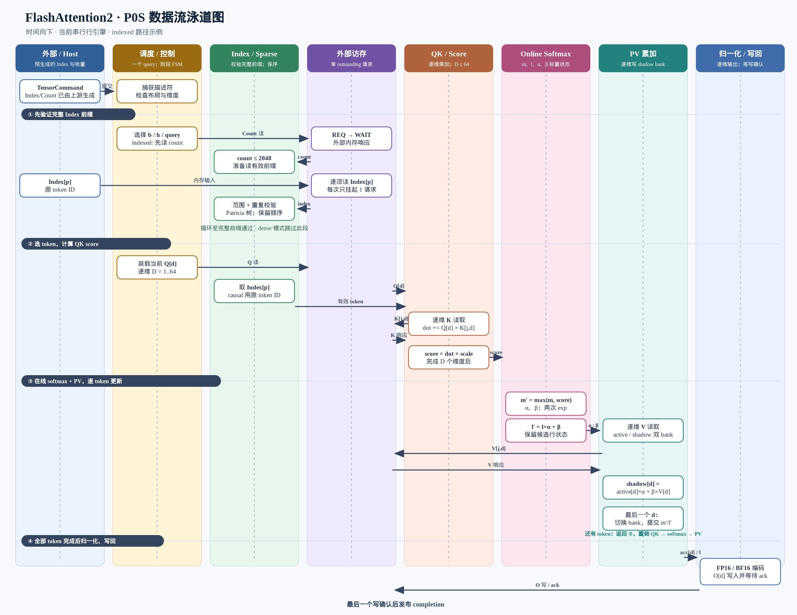

# FA2-CORE-DATAFLOW-SWIMLANE-1001：P0S 数据流泳道图

<!-- ndf: kind=mechanism modality=must refinement=L2 status=draft owner=flash_attention2 refines=FA2-CORE-ENG-0001,FA2-CORE-IDX-1001,FA2-CORE-COMP-1001 -->

这张图描述当前 **P0S 串行行引擎** 的数据流。Index 是外部提前产生的输入；硬件只
读取、校验并使用它访问线性 KV cache，不计算 top-k 或 index。每个 query 复用一个行引擎，
外部访存通道最多保持一个 outstanding 请求。



可放大查看 [SVG 原图](../assets/fa2-p0s-dataflow-swimlane.svg)。图中时间向下，横向
八个泳道分别是外部、调度、Index、访存、QK、online softmax、PV 和写回。

## 主数据流

```mermaid
flowchart LR
  subgraph H[Host / 上游]
    CMD[TensorCommand<br/>Q/K/V/O 描述符]
    IC[IndexCount<br/>每行 count]
    IX[预生成 Index<br/>uint32 token ID]
  end

  subgraph C[Scheduler / Controller]
    CAP[捕获 descriptor<br/>检查 layout / 地址 / D]
    ROW[选择 b,h,query<br/>生成 row command]
    FSM[PhaseController<br/>REQ / WAIT / DRAIN / DONE]
  end

  subgraph I[Index / Sparse]
    CR[读取 count]
    IR[读取 Index[p]]
    PT[Patricia 校验<br/>range + duplicate]
    IS[IndexStore<br/>保留原输入顺序]
    SEL[TokenSelector<br/>取原 token ID]
    MASK[Causal mask<br/>按原 token 判断]
  end

  subgraph M[Memory Port]
    PORT[单 outstanding<br/>MemoryRequest / Reply]
    KV[线性 KV cache]
    QMEM[Q buffer]
    AMEM[Accumulator<br/>active / shadow bank]
  end

  subgraph K[QK / Score]
    QLOAD[读取 Q[d]]
    KLOAD[读取 K[token,d]]
    DOT[非融合 dot<br/>add(sum, mul(Q,K))]
    SCALE[score = dot × scale]
  end

  subgraph S[Online Softmax]
    MAX[max(m, score)]
    ALPHA[alpha = exp(old_m - new_m)]
    BETA[beta = exp(score - new_m)]
    DEN[ l' = l×alpha + beta ]
    STATE[提交行状态<br/>m / l / bank]
  end

  subgraph V[PV / Vector Accumulate]
    VLOAD[读取 V[token,d]]
    RESCALE[shadow = active × alpha]
    ACCUM[shadow += beta × V]
    SWAP[最后 d 完成时<br/>切换 active / shadow]
  end

  subgraph O[Normalize / Writeback]
    NORM[O[d] = acc[d] / l]
    CAST[FP16 / BF16 encode]
    OWRITE[写 O[d]<br/>等待写响应]
    DONE[发布 completion]
  end

  CMD --> CAP --> ROW --> FSM
  IC --> CR --> PORT
  IX --> IR --> PORT
  PORT --> CR
  PORT --> IR
  IR --> PT --> IS --> SEL --> MASK
  FSM -. 控制阶段 .-> CR
  FSM -. 控制阶段 .-> IR
  FSM -. 控制阶段 .-> QLOAD
  FSM -. 控制阶段 .-> KLOAD
  FSM -. 控制阶段 .-> VLOAD
  QLOAD --> PORT
  PORT --> QMEM
  QMEM --> QLOAD
  MASK --> KLOAD
  KLOAD --> PORT
  PORT --> KLOAD
  KLOAD --> DOT --> SCALE --> MAX
  MAX --> ALPHA --> DEN
  MAX --> BETA --> DEN
  DEN --> STATE
  STATE --> VLOAD
  VLOAD --> PORT
  PORT --> VLOAD
  VLOAD --> RESCALE --> ACCUM --> SWAP --> STATE
  SEL -. token / address .-> KLOAD
  SEL -. token / address .-> VLOAD
  AMEM --> RESCALE
  AMEM --> ACCUM
  SWAP --> AMEM
  STATE --> NORM
  AMEM --> NORM --> CAST --> OWRITE --> PORT
  PORT --> OWRITE
  OWRITE --> DONE --> FSM
  FSM --> DONE

  classDef external fill:#e8f1ff,stroke:#3973b8,color:#102a43;
  classDef control fill:#fff3cd,stroke:#b58105,color:#4a3500;
  classDef index fill:#e7f7ed,stroke:#2e8b57,color:#123b24;
  classDef memory fill:#f1e8ff,stroke:#7b4ab5,color:#2d1748;
  classDef compute fill:#ffe8df,stroke:#c45a2a,color:#4c1f0e;
  class CMD,IC,IX external;
  class CAP,ROW,FSM,DONE control;
  class CR,IR,PT,IS,SEL,MASK index;
  class PORT,KV,QMEM,AMEM memory;
  class QLOAD,KLOAD,DOT,SCALE,MAX,ALPHA,BETA,DEN,STATE,VLOAD,RESCALE,ACCUM,SWAP,NORM,CAST,OWRITE compute;
```

虚线表示控制阶段选择，不表示额外的数据复制。实线表示数据或请求/响应关系。`PORT`
是唯一的外部请求入口：

1. `REQ` 被接受后进入 `WAIT`，响应到达前保持地址、大小和写数据；
2. 响应被接受后，才提交 count、Index、Q、K、V 或 O 的对应状态；
3. 取消发生在等待响应期间时进入 `DRAIN`，不会把迟到响应交给下一阶段；
4. 最后一个 O 写响应完成后才进入 `DONE`。

## 每个 token 的循环

对一个通过 Index 和 causal mask 的原 token，数据流按以下顺序重复：

```text
Q[d] × K[token,d] → dot → scale → score
                              ↓
                 max / alpha / beta / denominator
                              ↓
V[token,d] → alpha × active_acc[d]
          → beta × V[token,d] + rescaled_acc[d]
                              ↓
             shadow accumulator（逐 d 写入）
                              ↓ 最后一个 d
                    active/shadow bank 交换
```

`m`、`l` 和 accumulator 只在当前 token 的整行更新完成后切换；mask 项不发 K/V 请求，
也不参与 max、exp、denominator 或 PV 累加。indexed 模式的 token 是原始 token ID，
不是 Index 列表中的位置。

## 向量和三维阵列边界

当前 P0S 的 `RESCALE`、`ACCUM` 和 `NORM` 是逐维复用共享标量 ALU，D 的范围为 1..64。
P0T 的 16×16×16 阵列只覆盖 QK/PV 类乘加与树形归约，当前尚未把本图的 Index、online
softmax、SRAM gather 和 writeback 接入阵列，因此不能把 4096 个 MAC 单元解释为 4096
路 softmax。

## 关联文档

- [P0S 整机结构](fa2-core-eng-0001.md)
- [Index 读取和直接寻址](fa2-core-idx-1001.md)
- [共享计算数据通路](fa2-core-comp-1001.md)
- [标量传输协议](fa2-core-xfer-1001.md)
- [命令和阶段控制](fa2-core-ctrl-1001.md)
- [16×16×16 阵列](fa2-core-array3d-1002.md)
