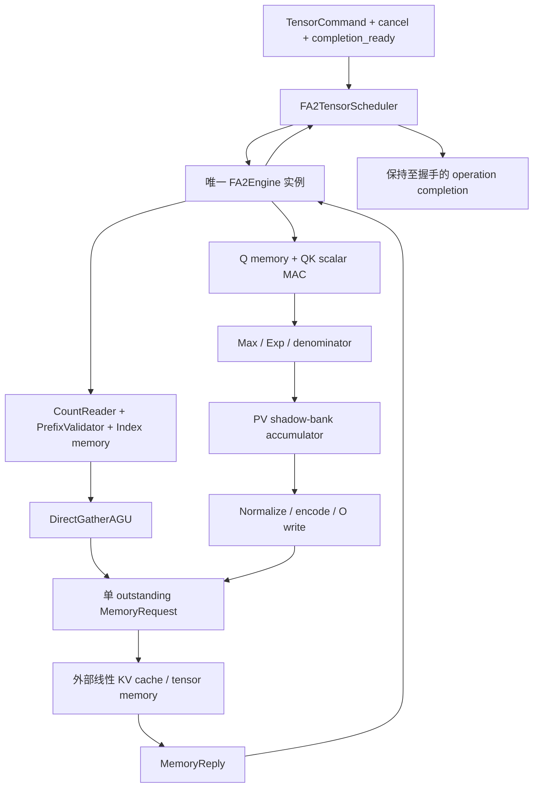

# FA2-CORE-ENG-0001：P0S 整机结构与实现分解 {#FA2-CORE-ENG-0001}

<!-- ndf: kind=mechanism modality=must refinement=L2 status=draft owner=flash_attention2 refines=FA2-CORE-0001,FA2-CORE-PROFILE-0001 -->

## 层级和物理职责

图中IndexReader、QK、PV等是内部职责；不要求每个框单独导出物理模块。源码层级
为scheduler→engine，engine包含PhaseController、IndexTrie和Datapath，后者调用numeric modules。
PhaseController独占phase/code；IndexTrie独占节点Memory与查找/插入状态；其余Memory和
计算进度由engine拥有，数值模块无状态。
共享运算单元通过phase选择操作数，跨周期结果存在engine寄存器。这样模块边界、资源
复用和状态owner均有确定实现，不只是一串业务处理名。

engine中的握手处理保留两级条件：外层Rule检查phase/cancel，内层Rule检查外部
request_ready或response valid。内层调用与外层属于同一事务，不增加周期、寄存器或
独立调度。先到达的未知控制值仍须触发整机提交失败，不能用后续的false条件掩盖。
Rule读取的结构体字段可以投影为组合标量wire；这些别名不拥有持久状态，也不改变
模块间的结构化接口。

| 源文件/模块 | 唯一职责 | 状态/端口 | 直接细化 |
| --- | --- | --- | --- |
| fa2_interfaces.py | 行命令、访存与状态类型 | typed Struct | 传输/控制 |
| fa2_scheduler.py::TensorLayoutValid | 对齐、布局、宽地址预检 | 无状态组合 | CTRL |
| fa2_scheduler.py::FA2TensorScheduler | tensor快照、b/h/query循环、全局终止 | 一个context、一个child | CTRL |
| fa2_engine.py::PhaseController | 阶段、错误和drain生命周期 | phase/code；独立状态owner | CTRL/XFER |
| fa2_engine.py::ControllerTransition | 译码、握手、错误优先级和下一阶段 | 组合；不访问Memory | CTRL |
| fa2_engine.py::Datapath | 组合操作数选择、算术、地址预检 | 无持久状态；结构化结果 | COMP |
| fa2_engine.py::FA2Engine | 单query在线attention | 三块memory、游标、行状态、单访存口 | BUF/IDX/XFER |
| fa2_engine.py::IndexTrie | 外部uint32列表精确重复检测 | 4096×64节点、root/allocator/遍历状态；TrieStatus | IDX-1003 |
| fa2_numeric.py::decode16/encode16 | FP16/BF16与binary32转换 | 组合 | COMP |
| fa2_numeric.py::fp_add/fp_mul/fp_div | RTZ/FTZ浮点编码运算 | 组合；显式位宽 | COMP |
| fa2_numeric.py::fp_exp_neg | 范围缩减、多项式、平方 | 组合；无指数查表 | COMP |

不存在外部score、weight、new_row_state输入；真正的DUT必须从Q/K/V和Index得到O。
Python数学Oracle只能生成测试期望，不能提供DUT内部结果或修补输出。

## 数据流与执行次序

1. 顶层捕获完整descriptor并校验整体地址范围/layout，按b、h、query嵌套顺序执行。
2. indexed读count及完整索引前缀并校验；dense跳过该阶段。
3. 装载该query的Q，解码、检查输入域并初始化active accumulator。
4. 取原token、执行causal筛选；有效token逐维读取K，累积dot并乘scale。
5. 更新候选max/alpha/beta/denominator；依次读取V并写shadow accumulator。
6. 最后一维成功后原子切换active bank及m/l；继续下一个token。
7. 列表耗尽，逐维normalize/encode，发送O写并等待每次确认。
8. 行完成后外层推进query/head/batch；最后一行的最后写确认后发布整机completion。

Index/count、Q、K、V、O读写全部经过同一外部接口，无隐式内存访问或软件回调。
数据流的时间隔离就是当前资源仲裁；没有预取或跨行并行，因此也不需要未实现的credit池。

## 片上边界与性能含义

P0S主要数据存储40.75KiB，其中索引树32KiB，与B/H/Sq/Sk总张量规模无关。dense最多2048个token，
indexed最多2048个所选token，cache逻辑长度可更大。完整S/P从不片外物化。

索引树每次遍历至多 32 层，两次遍历保持原索引顺序与错误优先级。
FP exp/div 是较深组合逻辑；生成 RTL 不代表已获得目标频率或算子时延。
P0T阵列方案保留在[并行候选](fa2-core-array-1002.md)，须单独实现和验收。

## 组合与构建约束

每个source单独compile成unit；接口快照必须相同，link输入列出完整unit closure。
C++与managed Verilog由同一verified final artifact生成。源码不暴露clk/reset、DFF
或physical SRAM pins；这些由编译器export及测试边界承担。

System测试由pyCircuit生成runner，独立期望值在test-owned代码中。编译预算错误、
行为断言失败和未运行项都分别报告，不允许以静态库构建替代C++执行。本次按用户要求
不执行Verilog仿真，仍从同一final生成Verilog。
旧16-entry/map原型已归档到historical，不进入P0S编译闭包。
