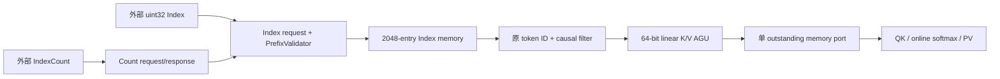

# FA2-CORE-IDX-1001：外部索引读取、完整前缀验证与直接寻址 {#FA2-CORE-IDX-1001}

<!-- ndf: kind=mechanism modality=must refinement=L2 status=draft owner=flash_attention2 refines=FA2-CORE-IDX-0001,FA2-CORE-PROFILE-0001 -->

## 模块边界与数据来源

Index 是外部输入。`IndexReader`、`PrefixValidator` 和 `DirectGatherAGU` 是 FA2Engine
内部的硬件职责，各由明确控制阶段实现，共享一个上下文和访存口。它们不计算选择分数，
不搜索 top-k，也不维护 token→物理地址的映射 SRAM。



| 职责 | 输入 | 输出/持久状态 | 控制阶段 |
| --- | --- | --- | --- |
| CountReader | count_base | count:u32；code2/5 | COUNT_WAIT |
| IndexReader | index_base+4*p | incoming_index:u32 | INDEX_WAIT |
| PrefixValidator / IndexTrie | incoming_index、key_length、当前树 | 精确membership、插入节点、indices[p]、p | 25/5、27..33，见IDX-1003 |
| TokenSelector | indices[p]或dense位置、mask | token:u32、开始K或跳过 | LOAD_TOKEN / MASK_TOKEN |
| DirectGatherAGU | token、K/V base/stride、d | byte address:u64 | request地址组合逻辑 |

## 精确算法与容量

indexed 模式先读 count。count>min(2048,S_k) 为 code2；count=0 跳过 Index 读。对每一项 p：

1. 读取 `Index[p]`；memory.error 为 code5。
2. 若 token≥S_k，报 code3，不能用低位截断成合法 token。
3. 在Patricia树中比较完整uint32叶key，相等则code4；独特key插入后才写indices[p]并推进p。
4. 最后一项完成后才允许 Q/K/V 计算；已 mask 的项仍须范围/重复检查。

精确树算法、4096×64节点布局和phase合同见[IDX-1003](fa2-core-idx-1003.md)。每次
遍历至多32个branch，独特key最多两次遍历；新增节点存储32KiB，原IndexStore仍保存输入顺序。取消和错误可提前终止，
下一行重建空树；无序合法，padding不读。运行验收以VALIDATION中的候选记录为准。

树不计算选择分数或 index，只检查外部列表。旧线性扫描与树实现的性能对照
属于独立测试记录，不构成此索引架构合同。

## K/V 直接地址

外层 scheduler 已算好当前 batch/head 的 K/V base，以及当前 query 的 index/count base：

```text
j = Index[b,h,i,p]                    # indexed
j = p                                # dense
K = k_base + j*k_row_stride + 2*d
V = v_base + j*v_row_stride + 2*d
Index = index_base + 4*p
```

K 与 V 独立 base 和 stride，同一个 token 寄存器贯穿 K dot 与 V update；地址生成不
依赖上一次 memory response 中缓存的映射。u32 token先扩为u64再乘，外层/行级
预检使用128位检查全部可达末字节。元素2-byte对齐，Index/count4-byte对齐。

paged cache、环形 cache、MLA latent、量化、GQA head映射均不在 P0S descriptor内。
调用方可提供已展开的线性视图；不能把 page ID 直接传作 token 并期待隐式翻译。

## Causal 与顺序

causal 先对原 token 做 `j≤query_position`；负 origin 形成空前缀时用 causal_empty
明确表示，不能使用 uint32 下溢。P0S 在发 K/V 请求前跳过 mask 项。因此其请求集合
正好是有效选择集与 mask 的交集，与早期“先 gather 再 mask”候选的事件 Oracle不同。
索引自身仍全前缀验证。dense 路径完全不读取 index/count。

P0S 每 token 依次读所有 K、计算 score/权重、再读所有 V。没有跨 token K/V交错，
不需要 packed-row token map、beat bitmap 或重排表。单 outstanding 和 drain 保证
请求与响应身份；这不赋予无 tag 接口处理任意陈旧响应的能力。

## 异常和验收

任何校验失败均禁止该 query 的 KV 读和 O 写；先前 query 已写的 O 仍使整次 tensor
结果无效。需要验证不同 query/head 的不同列表、token0、无序[7,2,5]、duplicate、
index==S_k、count2049、空列表、padding垃圾、u32高位token和独立 K/V stride。
完整路径测试必须观察真实请求地址和写结果，不能只测试地址 Python 函数。
