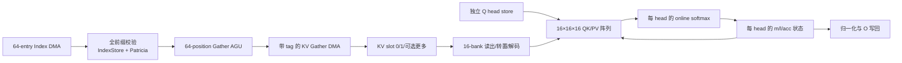

# FA2-CORE-SKV-1005：Shared-KV 批量 Gather 与多缓冲微架构 {#FA2-CORE-SKV-1005}

<!-- ndf: kind=mechanism modality=must refinement=L2 status=draft owner=sparsefa refines=FA2-CORE-SKV-0002,FA2-CORE-IDX-0001,FA2-CORE-BUF-0001,FA2-CORE-XFER-0001 -->

## 目标和实现边界

这是 P0T feeder、softmax 和整机调度的**目标设计**，不是当前 P0S 或独立
`Array16x16x16` 已实现的功能。当前 P0S 仍使用独立 K/V 描述符、单 outstanding
标量请求、完整前缀校验后逐 token 计算；当前三维阵列只接收预备好的操作数。
本页不能作为已生成 C++、RTL、带宽或 PPA 的证据。



## 命令和唯一状态 owner

建议新建独立的 `SharedKVCommand` 与 `SharedKVEngine`，不要在 P0S
`TensorCommand` 上悄悄重解释 `k_base/v_base`。命令携带 `B,H,Sq,Sk,D`、dtype、
scale、mask/origin、`q/kv/o/count/index` 的 base 和 byte stride、
operation tag 及取消。count/index 的 head stride 同时为零才启用共享列表
日程；一个为零而另一个非零时仍按每 head 的列表执行。`H,D` 在接受时固定，首版均为
1..64。`KV[b,j,d]` 没有 head 坐标；Q/O 仍有独立 head stride。描述符校验用
宽于 64 位的中间算术检查末字节、对齐、输出不重叠以及容量上限，再发任何请求。

| 模块 | 唯一拥有的状态 | 关键输出 |
| --- | --- | --- |
| CommandScheduler | operation/generation、`b,i`、head wave 和 64 项 batch 游标 | 给 index、gather、计算和写回的事务身份 |
| IndexLoader/Validator | count、2048 项有序 IndexStore、Patricia 节点与校验游标 | 完整前缀的 VALID 或首个错误 |
| GatherDMA | 请求 credit、tag→slot/position 表、未返回 fragment 位图 | KV slot 填充和错误/drain |
| KVSlotManager | 每个 slot 的 tag、状态、位置有效位、原 token ID | 已完整装载的共享 tile |
| HeadState | 最多 64 个 head 的 Q、`m/l`、PV accumulator 和有效性 | 独立 head 的下一批计算状态 |
| ArrayFeeder/Softmax | 16×16 操作数、score/weight scratch 和阶段游标 | 原子 QK/softmax/PV 组 |
| Writeback | O 写 tag、待确认数和完成状态 | 最后 ack 后的一次 completion |

模块之间传一个带 `operation,generation,b,i,batch,valid_count,list_identity,
consumer_kind,consumer_id` 的 tile 描述符。共享列表的 consumer 是 `head_wave`，
head-specific 列表的 consumer 是单个 `head_id`；`list_identity` 包含该次完整
前缀校验的 `(b,i,head_id 或 shared,count,index 视图,generation)` 身份，不能
只以 batch 序号或 KV base 判定命中。KVSlotManager 是 slot 元数据的唯一 owner；DMA 不直接宣告
READY，阵列不直接释放 slot。状态/Queue 的仲裁和可用性由编译器或真实接口控制，
不能用未验证的同拍组合链假定 DMA、SRAM 和 MAC 同时提交。

## Index 和 KV 传输

Index 连续区间按 `N=ceil(count/64)` 个事务处理，批 `t` 的有效项数为
`n_t=min(64,count-64*t)`，最多 32 批。一次满批的载荷是 256 B；总线可拆成
物理 beat，但必须按列表位置归并。即使响应乱序或某个 beat 报错，也要先还原
每个位置的值/错误，再按 `p` 递增校验，以保留首个错误的优先级；不能让较晚的
bus.error 抢在较早的越界/重复之前。每项先检查 `token<Sk`，再在精确校验结构中
检查重复，最后写 `IndexStore[p]`。所有批均验证后才发布该行的 VALID 屏障；
首个错误按原列表顺序报告，后续批不触发 KV 读取。共享 index 只校验一次，
head-specific index 对每个 head 分别建立校验身份。

VALID 后，GatherAGU 按相同的 64 个原列表位置装载 KV。每个被选中且通过 causal
的 token 发一个长度 `2*D` 字节的连续行读取：

```text
index_address(p) = index_base(b,h,i) + 4*p
kv_address(j,d)  = kv_base + b*kv_batch_stride + j*kv_row_stride + 2*d
```

Index 的 64 项是连续 burst；无序 token 对应的 KV 是至多 64 个 scatter 行片段，
**不能**把它们算作一个连续 KV burst。mask 掉的位置保留位置/token metadata，
不发 KV 读。只有确实相邻且布局允许时，DMA 才可合并行片段；合并不能改变列表
顺序、错误归属或原 token 的 causal 含义。K=V，因此每个有效 token 只装载一份
KV 数据，QK 和 PV 均从同一 slot 读取，不再产生独立的 K_READ/V_READ。

首版 DMA 建议至多 8 个已接受而未完成的 KV 行请求；实际 credit 在发送请求时
保留 slot 位置和响应装配容量。每行最多四个 256-bit 目标字；物理总线可在
任意字节边界拆分，响应 tag 至少含
`(operation,generation,slot,position,word,byte_offset,length)`。乱序返回的
fragment 按 tag 写入 8 行 × 4 字 × 32 B、最多 1024 B 的有界装配空间，
并维护每字有效字节位图；不允许把返回顺序当作 Index 顺序或以部分 fragment
直接覆盖 bank 中的旧字。重叠/越界或重复 fragment 报协议错误；末字未请求的
尾 byte 在装配空间补零。一个字的有效字节全部到齐后，bank 写仲裁才发起
一次完整 256-bit 写；已接受的响应到 bank 写完前持续占用 credit。
响应入口是可反压的 ready/valid 接口；若外部总线不能反压，适配器必须先
为全部已接受行预留等量响应空间，并保证同时到达的 beat 不丢失。
slot 只有在所有有效 fragment 成功返回、范围和数值域检查完成、所有装配字
写入 bank 后才成为 READY。
无 tag 的 P0S 单 outstanding 接口不能直接承担这个协议；需要新的 DMA/总线适配。

## KV slot 容量、bank 和读取

每个 slot 对最多 64 个列表位置保留原 token ID、有效位和一份 FP16/BF16 KV。
首版采用 16 个 token bank，`bank=position mod 16`，每 bank 存 4 个
16-position 组；维度按 16-lane 字分组，尾维填零但不能算作有效元素。
bank 内字地址为 `(position//16)*ceil(D/16) + d//16`，字内 lane 为 `d mod 16`。
每 bank 最多 1R1W；多个乱序 DMA 响应同时命中同一 bank 时，完整字留在
上述有界装配空间，写仲裁按 `(position,word)` 确定顺序逐字写入并反压
请求 credit，不能覆盖或丢弃响应。

| 数据 | 每 slot 最大容量，`D=64` | 双 slot | 三 slot |
| --- | ---: | ---: | ---: |
| KV 原始 16-bit 数据，`64×round_up(D,16)` | 8192 B | 16384 B | 24576 B |
| 原 token ID，64×uint32 | 256 B | 512 B | 768 B |
| 位置有效位，64 bit | 8 B | 16 B | 24 B |

表内数据合计每 slot 最多 **8456 B**；双 slot **16912 B**，三 slot
**25368 B**，不含 tag、credit、ECC、请求重排表、Q/score/accumulator、阵列
寄存器或 SRAM 宏开销。逻辑有效 KV 载荷为 `2*D*n_active` 字节，物理 slot
容量按 16 维对齐；例如 `D=1` 仍需每位置 16 个 16-bit 物理 lane。

每 bank 在一个阵列组读 16 个原始 16-bit 元素，即 256 bit；16 bank 同读
提供 512 B/cycle 原始 KV，解码后形成 256 个 FP32 操作数，即 1024 B/cycle。
QK 的 KV 操作数按 `[token,dim]` 输出；PV 经过明确的 16×16 转置使同一数据变成
`[dim,token]`。Q 或概率侧另需 1024 B/cycle FP32 操作数，合计仍是原独立
[ARRAY3D-BUF-1004](fa2-core-array3d-buf-1004.md) 指出的 2048 B/cycle
满速组输入要求。此 bank/转置网络和同步读延迟尚未实现，不能把外部 KV 带宽
与片上阵列带宽混为一谈。
每个 slot 有物理独立的 16-bank 阵列，因而 slot 0 的同步读和 slot 1 的
DMA 写可以同拍进行；同一 slot 的 bank 为 1R1W，读/写地址碰撞不得透传
未定义数据。首版仅 FILLING slot 接受写、IN_USE slot 接受读，因此不依赖
同址读写结果。SRAM 读请求至少跨一个接受边沿后才能返回；feeder 用
`(slot,bank,word,group)` tag 对齐 16-bank 响应，未全部到达就不提交阵列组。
bank 写冲突、读响应等待或转置占用都产生真实反压，不计作免费带宽。

HeadState 为最多 64 个 head 保留 Q 和 PV accumulator：各最多
`64×64×4 = 16384 B`，另有 `64×2×4 = 512 B` 的 `m/l`；每个 16-head wave
的 score/weight scratch 至多 `16×64×4 = 4096 B`，可以同址分阶段复用。
另需当前 wave 的 batch-PV 候选 `16×round_up(D,16)×4`，最多 4096 B；
候选 `m/l` 最多 128 B。只有整批发布时才覆盖 HeadState 的旧值。
这些容量是目标数据预算，不计控制或阵列的 32 KiB 算术寄存器，也不意味着
已经完成 SRAM 综合。

## 双缓冲与多 Head 计算日程

slot 状态按 `FREE → FILLING → READY → IN_USE → FREE` 推进；取消/故障从任何
占用状态转入 `DRAINING`，所有旧响应清空后释放。生产者只能写 FILLING，
消费者只能读 READY/IN_USE 且 tag 匹配的 slot。读取端最后一个已接受访问
真正完成前，不能将 IN_USE 变回 FREE。多 slot 使用同一规则和有界 credit，
不是无限预取。

```text
完整 Index 前缀校验通过
时间 ↓           slot 0                    slot 1                 阵列/每 head 状态
阶段 A           填充 KV batch 0           FREE                   等待
阶段 B           供 batch 0 给所有 head    填充 KV batch 1        QK → softmax → PV
阶段 C           填充 KV batch 2           供 batch 1 给所有 head QK → softmax → PV
...              只在释放后复用             只在释放后复用         最后一批后归一化
```

共享 index 时，先为一个 `(b,i)` 装载最多 64 个 Q head 并初始化各自状态。
每个 KV batch 在 slot 中保持到 `ceil(H/16)` 个 head wave 全部完成；每 wave
的 16 行对应 16 个不同 head，同一 KV tile 广播给这些行。QK 阶段的 `m`
是 head、`n` 是 token、`k_lane` 是维度；PV 阶段的 `m` 仍是 head、`n`
是输出维度、`k_lane` 是 token。score、`m/l` 和 acc 按 head 独立，尾 head、
尾 token、尾 D 用 mask。不同 batch 之间保留各 head 的 online softmax 状态，
不物化完整 S/P。

## 逐批数值顺序和提交边界

对一个 head、一个已装载 batch，先将每个有效 token 的 QK 点积按 D 维
16-lane 组送入三维阵列：组内乘积及四层相邻配对树、跨维组按递增顺序累加，
均遵循 [ARRAY3D-1002](fa2-core-array3d-1002.md) 的非融合 RTZ/FTZ 合同；
再以一次 RTZ/FTZ 乘法施加 `scale` 得 `s_p`。被 causal 排除的 token 不参与
最大值、分母、PV 或任何树叶；尾 lane 只贡献确定的 `+0`，不读取无效 KV。

每 head 的旧状态是 `(has_value,m,l,acc[d])`，初始
`(false,0,0,0)`。非空 batch 的候选状态定义如下，所有表达式中的加、乘、
exp 和最终除法分别按既有有限 binary32 RTZ/FTZ 数值 profile 舍入，不使用 FMA：

```text
bmax    = max(s_p, p 为本批有效位置)
m_new   = has_value ? max(m, bmax) : bmax
alpha   = has_value ? exp(m - m_new) : 0
w_p     = exp(s_p - m_new)
b_l     = sum_tree_and_groups(w_p)
b_acc[d]= sum_tree_and_groups(w_p * KV[token_p,d])
l_new   = add(mul(alpha,l), b_l)
acc_new[d] = add(mul(alpha,acc[d]), b_acc[d])
```

`exp` 的输入均非正，使用 [COMP-1001](fa2-core-comp-1001.md) 的
`fp_exp_neg` 合同。每个 16-token 组的 `b_l` 使用固定四层相邻配对树；
`b_acc[d]` 使用阵列 PV 的相同 16-lane 乘积/相邻树。无效 token lane 在
两个归约中注入 `+0`，四个 token 组按位置递增各自累加，最后再作一次旧状态
重标定加法；每个树节点、组间加法和重标定运算各自舍入。`bmax` 对有效
score 做 16-lane 树最大值，再按组递增取最大值；最大值比较不用编码位序。
`has_value=false` 时跳过旧状态项，避免 `0*exp` 的无意义路径。全被 mask
或空 batch 保持旧状态和 `has_value` 原值，不做除零或写回。

每个 wave 的 QK 先按最多四个 16-token 列 tile、每 tile 最多
`ceil(D/16)` 个维度归约组执行；满批 `n=64,D=64` 时共接受 **16 个**
阵列 GROUP，形成至多 64 个 score。完成 `bmax/w_p` 和分母候选后，PV
按最多 `ceil(D/16)` 个 16-output-dim 列 tile、每 tile 最多四个
16-token 归约组执行；满批 `n=64,D=64` 也接受 **16 个** GROUP，
覆盖全部 64 个输出维。每个列 tile 都是独立阵列事务，依次
`begin → GROUP×G → END → drain → take`；满批 D64 的 QK 与 PV 各需
四次 begin/take，不能把 16 个 GROUP 算成一次阵列事务或省略流水排空。
尾部 tile 用有效 lane mask，空 batch 不发 GROUP。
score/weight scratch 分阶段复用；某组概率在对应 PV 被接受并完成前不得覆盖。
同一 head 的 `m,l,acc,has_value` 仅在该 wave 的整个 batch QK、softmax、PV
均完成且无错误时作为一个事务发布；失败、取消、tag 不符或阵列气泡都不能
部分发布。不同 wave 的 head 状态彼此独立。最后一批后，有值的 head 对每个
有效 D 作 `O[d]=acc[d]/l` 并编码输出；从未有有效 token 的 head 输出零，
与现有空集合合同一致。候选数值精度是目标合同，不能声称与旧 P0S 逐 token
结果逐位相同。

head-specific index 模式必须对每个 head 的完整列表分别校验。该模式使用相同
64 项 loader 和双 slot。首版按 `head_id` 递增，一次只使一个 head 的列表
处于计算/预取状态：先验证该 head 的完整前缀，再装载它的 batch 0；消费
batch `t` 时只预取**同一 head** 的 batch `t+1`，直到该 head 写回完成才
切到下一 head。slot tag 必须同时匹配 `list_identity,head_id,batch`，阵列
只开该 head 的一行、其余 15 行 mask；不能按共享列表的 16-head 广播。
首版跨 head 不命中复用，即使两个列表内容相同也重新装载；以后若增加复用，
必须用完整 token 序列、有效位、KV 映射、D、dtype 和 generation 的精确匹配
证明身份。“KV 物理共享”不等于“每个请求只读一次”。

## 传输掩盖、反压和失效

设一次 batch 的实际装载时间为 `T_load`，消费所有 head wave 的时间为
`T_compute`。双 slot 在已完成首批预取后，只有当每次
`T_load <= T_compute` 且 bank/总线无额外冲突时才可能持续隐藏传输；否则
阵列必须等待 READY。三 slot 可吸收有限抖动，不能消除长期带宽不足。
可估外部读字节数：共享列表时每 `(b,i)` 的有效 KV 最少为
`2*D*N_active`，而不是 `H*2*D*N_active`；再加 Q、Index、O 和可能的重读。
这是流量下界，不是已测带宽或加速比。

取消立即停止新 DMA/计算/写回，已接受请求按 tag/generation 消费并丢弃旧响应；
错误优先级仍由完整前缀校验及总线错误定义。不能靠清 slot valid 位假装外部请求
已完成。operation 的 O 在错误/取消后整体无效，已确认写不能撤销；正常 completion
必须等待所有 head 的最后 O 写响应。复位后的旧 tag 要求真实 bus fence/reset
或可证明的 generation 隔离，不能凭有限计数器回绕后继续使用陈旧响应。

逐批流水和八泳道图见[SKV 泳道图](fa2-core-skv-swimlane-1005.md)。
