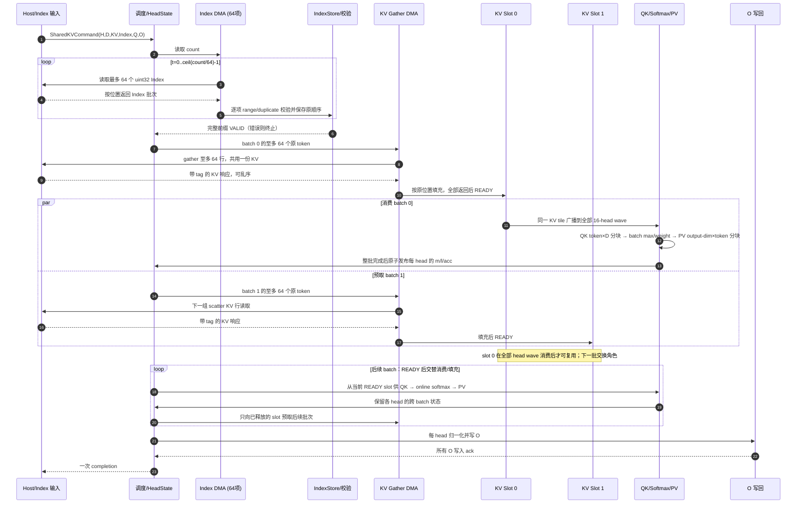

# FA2-CORE-SKV-SWIMLANE-1005：64-Index 与共享 KV 双缓冲泳道图

<!-- ndf: kind=mechanism modality=may refinement=L2 status=draft owner=sparsefa refines=FA2-CORE-SKV-0002,FA2-CORE-SKV-1005 -->

下图是**目标并行架构**的事务顺序，不是当前 P0S 的实测逐拍日志。
时间向下；Index 由 Host 提前产生，K 和 V 是同一份 `KV[b,token,d]`。
为了保持当前完整前缀校验的错误边界，所有最多 64 项的 Index 批次先验证完，
再开始本行的 KV 请求。双 slot 的重叠发生在后续 KV batch 装载与计算之间。

对于 head-specific Index，每个 head 的 Index 前缀须独立验证；KV 仍来自同一
共享 cache，但首版按 head 顺序一次处理一个列表，slot 绑定
`list_identity,head_id,batch`，阵列只启用该 head 行。消费其 batch `t` 时
仅预取同一 head 的 batch `t+1`；列表不同的 tile 不能仅按 `batch` 位置复用。
无论双缓冲还是三缓冲，
DMA 返回慢时 MAC 等待 READY；图中的并行分支不承诺固定 II 或零停顿。
详细 tag、bank、容量和失效规则见 [SKV-1005](fa2-core-skv-1005.md)。
