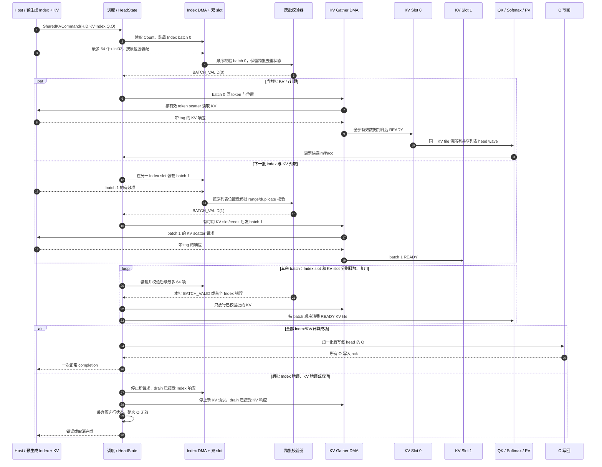

# FA2-CORE-SKV-SWIMLANE-1005：Index/KV 双缓冲数据流

<!-- ndf: kind=mechanism modality=may refinement=L2 status=draft owner=sparsefa refines=FA2-CORE-SKV-0002,FA2-CORE-SKV-1005,FA2-CORE-IDX-STREAM-1007 -->

下图只表达目标架构的事务依赖和可重叠关系，不表达周期数或固定算子时延。
Index 由 Host 提前产生，K 和 V 是同一份 `KV[b,token,d]`。每个 64 项
Index 批次单独校验并放行对应 KV；跨批查重状态持续保留。Index slot 与
KV slot 各有两个，编号不要求相同。

Index slot 在本批所有位置已发 KV 请求或因 mask 跳过，且 metadata 已复制
到 KV slot 后释放；KV slot 在所有需要的 head wave 消费完后释放。较晚批
发现重复、越界或总线错误时，先前批可以已经发过 KV 请求，但 O 尚未写回。
head-specific Index 逐 head 使用同一规则；首版一次处理一个 head 的列表，
不把不同 head 的同号批次当作同一 tile。总线和 slot 反压使重叠成为条件能力，
详细状态与错误优先级见 [IDX-STREAM-1007](fa2-core-idx-stream-1007.md)
和 [SKV-1005](fa2-core-skv-1005.md)。
