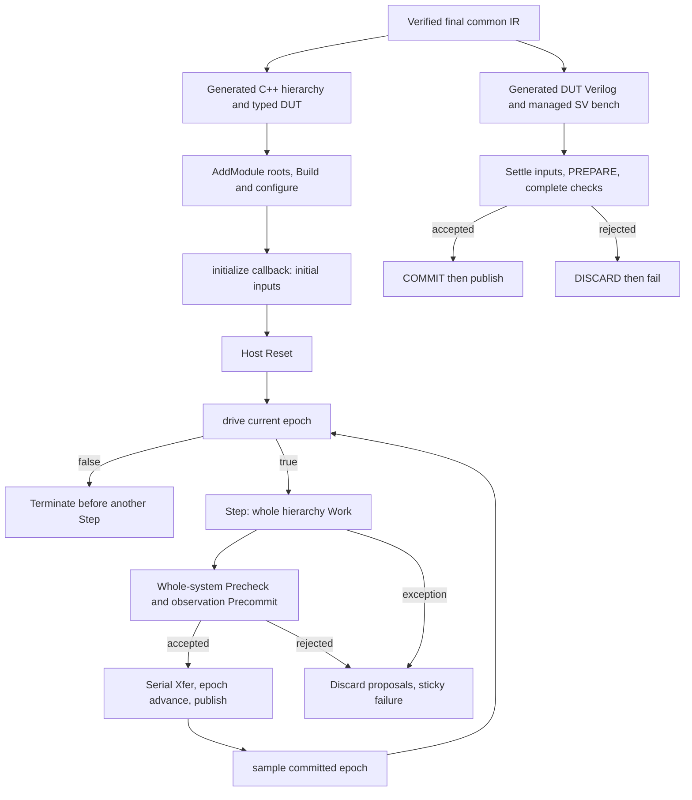

# System host I/O and UVM integration design

Status: design research for [issue #337](https://github.com/PTO-ISA/pyCircuit/issues/337)
(I15 of the ACIR publication bundle, RFC §22), based on
[`878f17dd`](https://github.com/PTO-ISA/pyCircuit/tree/878f17ddb1308a49368023167787c165245c4562).
This document proposes boundaries and prototype acceptance; it does not approve a
new System API or deliver a Python host binding, program loader or UVM adapter.
External evidence was retrieved on 2026-10-20.

Ordinary authors use Python Modules, Rules and a closed `@ac.system`, then the
existing compile/link/emit and generated simulation flow. Start with
[System execution](system-execution.md), the
[frontend guide](../development/agent-frontend-guide.md#four-state-checks-and-finite-system-stimuli)
and [build and run](../getting-started/tutorial.md). The lifecycle and callbacks
below are advanced host/backend integration concerns; ordinary authors do not
write Work/Xfer or compiler-owned clock/reset plumbing.

## Current boundaries

All routes share Python syntax capture → independent source units → MLIR
analysis/lowering → linked, verified common IR. Capture does not execute design
functions as a Python testbench. The DUT retains its full module hierarchy.

| Composition or artifact | Current responsibility | External integration boundary |
| --- | --- | --- |
| Closed `@system` | Root-only hardware composition containing DUT instances, stimulus state, checks and observations; no authored data arguments/results. | Generated controls drive clock/reset. Finite cycles or literal domain samples are available; external data I/O is not provided by the closed signature. |
| Ordinary Module and typed C++ DUT | `pyc_dut::Inputs/Outputs`, `drive`, `sample`, `system` and `observations` support a custom C++ host. | A Python/native binding and its ownership/error contract remain to be designed. |
| Ordinary Module RTL | Data/results and inferred domain ports are the external DUT boundary. Managed source checks add lifecycle/error controls. | A verification wrapper must honor the selected execution policy. `ports.json` describes exported ports and availability, not a UVM interface or internal memory path. |
| Managed SV simulation bench | Generated `simulation_top.sv` owns timed tasks, startup, PREPARE, validation, COMMIT/DISCARD and publication. | Its `initial`, delays and `$fatal` are nonsynthesizable verification scaffolding; it is not the synthesizable DUT. |
| Physical-edge RTL export | Existing bounded export for ordinary single-domain register hierarchies; rejects closed Systems. | It is not a general replacement for managed sampling, discard or memory/queue execution. |

The [source-unit workflow](../development/source-unit-workflow.md) describes
current `ports.json`, `root_rtl_name` and physical-export support. The older
[physical export design](../development/physical-rtl-export.md) retains proposal
wording; current support is bounded by the implementation and active workflow.
Source checks, source ownership and the shared final artifact remain authoritative
for every integration option.

## Existing execution lifecycle

The reusable owners are
[`SimSystem`](https://github.com/PTO-ISA/pyCircuit/blob/878f17ddb1308a49368023167787c165245c4562/include/gfsim/SimSystem.h),
[`RunnerCallbacks`](https://github.com/PTO-ISA/pyCircuit/blob/878f17ddb1308a49368023167787c165245c4562/include/gfsim/SystemRunner.h)
and [`SystemRunner::Run`](https://github.com/PTO-ISA/pyCircuit/blob/878f17ddb1308a49368023167787c165245c4562/runtime/system_runner.cpp#L465-L557):

- `AddModule` registers unique roots before Build; parents reach nested children.
  The runner's executor builds/configures the model, invokes `initialize`, then
  performs host Reset. Initialization establishes complete initial input pins.
- `drive(epoch)` runs on the control thread before Step. A false return ends the
  input stream before another epoch. One Step is one sampling epoch, not one
  clock period; a host explicitly supplies clock levels.
- All Work completes before whole-system Precheck and observation Precommit.
  Only success permits serial Xfer, epoch advancement and observation publication.
  Work/check failure discards proposals across all owners, including clock history.
  There is no new Tick API or alternate scheduler.
- `sample(committedEpoch)` runs only after a successful nonquiescent Step. The
  typed DUT output is that Work's **old-state snapshot**; postcommit callback
  invocation does not imply reevaluation of outputs. `sample()` rejects before
  the first successful epoch and after failure. Drive/sample must not race Work.
- Driven runners use finite `max_ticks` in sampling epochs and reject
  `max_domain_cycles` until a domain-driver contract exists. Host Reset, a
  synchronous hardware reset sample and a fresh-DUT cold restart differ. Only
  host Reset clears sticky runtime failure; memory Reset retains contents.

The generated
[native main](https://github.com/PTO-ISA/pyCircuit/blob/878f17ddb1308a49368023167787c165245c4562/compiler/lib/Compiler/FinalEmitCpp.cpp#L141-L247)
installs initialize/drive and a **null sample callback**. It defaults to ten
low/high cycles, or follows explicit finite `samples`; explicit cycles conflict
with samples. Runner configuration controls execution limits and reporting; it
is not a general DUT input or program-image format.

The generated
[SV bench](https://github.com/PTO-ISA/pyCircuit/blob/878f17ddb1308a49368023167787c165245c4562/compiler/lib/Compiler/FinalEmitVerilog.cpp#L498-L550)
settles inputs before PREPARE, requires complete snapshots and exactly-zero error
channels, validates observation groups, then freezes permission before COMMIT.
Startup uses RESET_PREPARE/COMMIT. A UVM wrapper must preserve these semantics
when targeting managed RTL. An ordinary gated clock or a postcommit fatal message
cannot substitute for the whole-system permission barrier.

Failed epochs publish no new observations. Output-sink failure after a successful
commit cannot undo hardware state or bytes already written. Future host error
mapping must preserve that distinction and the existing log/observation format.

## Memory and program I/O gaps

Primitive preload/readback mechanisms already exist:
[`sync_mem::pokeEntry/peekEntry`](https://github.com/PTO-ISA/pyCircuit/blob/878f17ddb1308a49368023167787c165245c4562/include/gfsim/sync_mem.h#L193-L199)
and [`byte_mem::pokeByte/peekByte/peek32`](https://github.com/PTO-ISA/pyCircuit/blob/878f17ddb1308a49368023167787c165245c4562/include/gfsim/byte_mem.h#L150-L164).
`peek32` assembles little-endian bytes. Out-of-range pokes silently do nothing
and reads return zero; these accessors are not a validated image loader.

| Need | Existing basis | Decision or implementation gap |
| --- | --- | --- |
| Image loading | Typed entry and byte accessors; test-owned literal vectors. | Select byte/entry format, address units, endianness and partial-word rules. No dedicated program/ELF loader was identified in the runtime/emitter owners reviewed. |
| Memory binding | Primitive objects in generated hierarchy. | Stable owner identity, type/extent discovery, allowed visibility and backend mapping. Public port metadata does not expose a stable memory backdoor. |
| Safe initialization | initialize callback before host Reset; memory contents survive Reset. | Preflight all bindings, bounds and overlaps before mutation; define reload/Reset/cold-run policy and forbid mutation during an active epoch. |
| Input and output | Ordinary Module typed drive/sample; source logs/reports. | External framing, complete-row validation, result collection, four-state encoding and Python object lifetime/error mapping. |
| Completion | Finite drive stream, runtime limits, failure metadata. | Separate workload completion, exhausted input, quiescence, timeout and DUT error; choose a test-owned completion oracle. |
| Build and SDK | Source-owned generated CMake, reusable modules target and Runtime package. | Pin platform/dependency matrix and any binding packaging; source portability requires builds on each platform, not one universal binary. |

A minimal future experiment can preload the existing byte/entry test vectors and
replay existing finite requests. It does not need a new CPU, ISA implementation
or ELF parser. Complete consumer programs, memory maps and ISA-specific loading
remain in their owning repositories. Generated-System memory exposure requires
an explicit reviewed contract before implementation.

## Integration options for decision

| Option | Reuse | Tradeoff and unresolved boundary |
| --- | --- | --- |
| Extend generated closed-System stimulus | Existing System analysis, generated main and managed bench. | Decide how external data enters a currently closed source signature without executing captured design Python or changing ownership implicitly. |
| Python host calls ordinary typed Module | Existing C++ DUT and initialize/drive/sample callbacks. | Smallest existing data boundary; choose binding technology, lifetimes, exception handling and complete input/output representation. No binding is selected here. |
| UVM drives generated DUT Verilog | Existing SV simulator executes UVM; Module RTL and a verification-side wrapper connect to an agent. | Decide managed versus admitted physical policy, interface/modport shape, clocking/monitor regions and hierarchy/backdoor mapping. Python may orchestrate build/launch. |
| UVM drives GFSIM | Existing Step, typed DUT and atomic barriers. | Separate co-simulation project: choose transport and scheduling owner. DPI-C is one candidate, not an approved implementation or an atomic-commit protocol. |

Generated C++ does not itself execute UVM. Reusing a testcase, sequence or BFM
requires matching its protocol, agent configuration, widths, availability,
clock/reset and sampling assumptions. Every hierarchical backdoor reference
needs an explicit mapping and access check; matching root port names is
insufficient. Managed controls belong in compiler/backend integration, not
handwritten ordinary DUT sources. The current reviewed runtime/emitter owners
contain no ready UVM/interface/modport/DPI adapter generation.

## Pinned simulator and UVM research

The proposed compatibility experiment is **Verilator 5.052 with Accellera UVM
2020-3.2**, not an installed or validated pyCircuit baseline. Local research
inventory found Verilator **5.044** (`vUNKNOWN-built20260101`) and Icarus **12.0
stable**. No new simulator or UVM package was installed or executed for this
design. Icarus remains the existing four-state verification lane; this document
makes no Icarus UVM compatibility claim.

| Official evidence | What it establishes and limits |
| --- | --- |
| [Verilator 5.052 release notes](https://github.com/verilator/verilator/blob/ea338be98e1e838d3518809ce8899f85a009963c/Changes#L13-L18), pinned upstream commit `ea338be98e1e838d3518809ce8899f85a009963c` | Announces UVM 2020-3.2 support and points to limitations; a blanket claim that Verilator cannot run UVM is incorrect. |
| [Official UVM support tracker #1538](https://github.com/verilator/verilator/issues/1538), retrieved 2026-10-20 | Lists supported/debugged UVM versions and remaining restrictions, including X/Z-dependent code. It is mutable upstream evidence, not pyCircuit execution evidence. |
| [Pinned language guide](https://github.com/verilator/verilator/blob/ea338be98e1e838d3518809ce8899f85a009963c/docs/guide/languages.rst#L249-L257) | Verilator is mostly two-state; retain a separate four-state oracle for X/Z behavior. |
| [Pinned DPI guide](https://github.com/verilator/verilator/blob/ea338be98e1e838d3518809ce8899f85a009963c/docs/guide/connecting.rst#L173-L178) and [VPI guide](https://github.com/verilator/verilator/blob/ea338be98e1e838d3518809ce8899f85a009963c/docs/guide/connecting.rst#L381-L410) | Foreign calls and limited public-signal access exist; visibility, evaluation and callbacks require explicit handling. Neither establishes a GFSIM adapter. |
| [Accellera downloads](https://www.accellera.org/downloads/standards/uvm) and [official 2020-3.2 archive](https://www.accellera.org/images/downloads/standards/uvm/1800.2-2020.3.2%20Release.gz) | Pins reference kit 1800.2 2020.3.2. Retrieved archive: 754457 bytes, SHA-256 `4664ac015f23c72106dd785906aa874d70932ea63f74b85de1e32fa5339c15eb`. Its README requires vendor compatibility; legacy API/stream differences require review. |
| [Upstream UVM hello with DPI](https://github.com/verilator/verilator/blob/ea338be98e1e838d3518809ce8899f85a009963c/test_regress/t/t_uvm_hello_all_v2020_3_2_dpi.py) and [without DPI](https://github.com/verilator/verilator/blob/ea338be98e1e838d3518809ce8899f85a009963c/test_regress/t/t_uvm_hello_all_v2020_3_2_nodpi.py) | Upstream has executable UVM hello tests. These do not validate a pyCircuit connection or select DPI for this design. |

The proposed first subset is one clock domain, known-valued ready/valid traffic,
one concrete sequence/agent configuration and explicit driver/monitor timing.
Arbitrary UVM compatibility is outside that claim. Pin each tested testcase and
build flags; probe clocking behavior and finish handling explicitly while
[#7688](https://github.com/verilator/verilator/issues/7688) (virtual-interface
clocking propagation) and [#7213](https://github.com/verilator/verilator/issues/7213)
(`$finish` continuation) remain relevant upstream limitations.

No existing UVM testcase was supplied in this repository scope. Selecting an
actual reusable external testcase and documenting its assumptions is a required
input to a later UVM prototype, not permission to invent an unbounded test suite.

## Existing fixtures and independent expectations

These are source/test contracts at the pinned repository base, not fresh
simulation results for this documentation candidate. They constrain later
prototypes to existing workloads.

| Existing fixture | Loading/stimulus and finite stop | Independent expected result |
| --- | --- | --- |
| [`source_system/bench.py`](https://github.com/PTO-ISA/pyCircuit/blob/878f17ddb1308a49368023167787c165245c4562/tests/system/fixtures/source_system/bench.py) and `dut.py` | Source-owned phase drives two accumulators; no image load. Host Reset then low/high pairs. Four cycles are eight successful epochs. | At epochs 0–7, left is `[0,0,1,1,1,1,2,2]`; right and progress are `[0,0,1,1,2,2,3,3]`. Each record has `epoch_time=e`, `commit_time=e+1`. Result TERMINATED at epoch 8, progress 3. A five-cycle request fails at evaluation epoch 8 and publishes only the first eight epochs. |
| [`memory_banks/bench.py`](https://github.com/PTO-ISA/pyCircuit/blob/878f17ddb1308a49368023167787c165245c4562/examples/memory_banks/bench.py) | Existing 26-row source table; writes 41, 91 and `0x3333`, readbacks and sink stalls. CMake requests 26 low/high cycles (52 epochs). | Source assertions check ready, output validity and every live response field. It is a generated closed System scenario, not a UVM test. |
| [`memory_banks/driver.cpp`](https://github.com/PTO-ISA/pyCircuit/blob/878f17ddb1308a49368023167787c165245c4562/examples/memory_banks/driver.cpp) and [`rtl_tb.sv`](https://github.com/PTO-ISA/pyCircuit/blob/878f17ddb1308a49368023167787c165245c4562/examples/memory_banks/rtl_tb.sv) | Existing finite ready/valid rows and independent RAM/queue oracle; drive stops at `rows.size()`, with bounded drain loops. SV replays `memory-banks-oracle.rows`, comparing prepared outputs before commit; rows come from the oracle, not native DUT output. | First five responses contain old data `[0,0,41,91,0]`, retaining request fields/tags. Bank 3 reads `0x3333`; reset retains committed RAM. Existing checks cover stalls, saturation, held clocks, canceled tags, ordering and zero pending work. Do not replace the generated row count with an assumed fixed duration. |
| [`TypedMemoryTest.cpp`](https://github.com/PTO-ISA/pyCircuit/blob/878f17ddb1308a49368023167787c165245c4562/tests/runtime/TypedMemoryTest.cpp) | Existing byte preload `0x34,0x12` at addresses 2,3; explicit finite Work/Xfer/falling-edge samples. | Initial old-state read `0x1234`; upper-byte strobe commits `0xab34`, visible on the next Work; discard preserves bytes. Typed entry tests cover old-data collisions, bounds, unknown controls and Reset retention. |
| [`atomic_bench.py`](https://github.com/PTO-ISA/pyCircuit/blob/878f17ddb1308a49368023167787c165245c4562/tests/system/fixtures/source_system/atomic_bench.py) | Two state owners prepare writes before a deliberate failed assertion. | Rejected epoch preserves both owners, clock history, epoch and prior observations; existing generated native/RTL probes check discard and retry behavior. |

The accumulator oracle and failure checks are in
[`test_source_system_execution.py`](https://github.com/PTO-ISA/pyCircuit/blob/878f17ddb1308a49368023167787c165245c4562/tests/system/test_source_system_execution.py#L1717-L1733)
(`_assert_success`, `test_closed_system_generated_cpp_and_verilator_observations`
and the atomic probes). Reuse those expectations and existing test entrypoints;
keep independent oracles outside product lowering and adapters.

## Unresolved decisions and prototype acceptance

Before implementation, decide the host binding and lifetime rules, complete
input/output representation, memory identity and initialization policy, completion
oracle, simulator/UVM subset, wrapper sampling regions and backdoor visibility.
For GFSIM co-simulation, additionally decide one scheduling owner, transport,
error propagation and reset mapping. DPI return is not a commit boundary.

Actual integration depends on [I03 / #325](https://github.com/PTO-ISA/pyCircuit/issues/325)
(reloadable anchors and independent Module bodies) and
[I05 / #327](https://github.com/PTO-ISA/pyCircuit/issues/327) (cycle-accurate high-level
C++ and GFSIM); extern or co-simulation also depends on
[I04 / #326](https://github.com/PTO-ISA/pyCircuit/issues/326) (extern backend bindings).
Design review can proceed before those slices,
but cannot establish their implementation readiness. The next bounded prototype
must satisfy the following acceptance plan:

1. Freeze a candidate, workload bytes, final-IR identity, generated manifests,
   Runtime package and host/simulator/UVM versions and flags. Build from that
   candidate checkout through existing compile/link/emit and SDK routes.
2. Replay the accumulator and memory-bank fixtures above in native workers 1/2
   and managed RTL. Compare each sampling epoch, ready/valid decision, old-state
   output, ordered observation and completion/failure result. Preserve their
   original reset, held-clock, stall and failure scenarios.
3. For a proposed memory binding, use the existing byte/entry vectors first.
   Reject invalid ownership, range, overlap or image shape before any mutation;
   prove readback, partial strobes, Reset retention and fresh-DUT cold state.
4. For UVM-to-Verilog, select one actual existing testcase/sequence, freeze its
   agent/configuration and map every interface and backdoor access. Prove driver,
   monitor and clocking-region timing against the same finite stimulus; report
   any unsupported legacy API, hierarchy or simulator feature explicitly.
5. For UVM-to-GFSIM, specify scheduling before transport implementation. One
   owner drives a complete epoch, calls existing Step, samples only success and
   stops on failure without another commit. Test input exhaustion, timeout,
   host Reset and sticky failure independently.
6. Inject failure after multiple owners prepare and verify zero state, clock
   history or epoch advance and no failed-epoch publication. Test observation
   validation separately from sink failure after a successful commit.
7. Retain four-state Icarus checks for X/Z; mostly two-state UVM simulation cannot
   replace them. Record PASS, FAIL and NOT RUN cells with candidate-bound evidence
   in the existing gate structure. No adapter or loader completion claim follows
   from acceptance of this design document.
