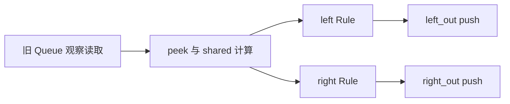

# 编译阶段的设计意图：一些笔记

先记下这份笔记的范围。这里讨论的是：把 ACPy 描述的资源、计算、控制流和事务保存下来，让后续分析和执行都有足够的信息。记录的重点是各阶段想保住的语义，以及这些信息为什么有用；具体怎样组织 pass、怎样求解关系，留给实现文档。

读一份编译产物时，我希望能顺着源代码找出：一个值来自哪里，在哪条路径上有效，读的是哪份状态，哪些 Rule 使用它，以及状态修改最终属于哪条事务。只列出资源和 Rule 名字，还不足以回答这些问题。

当前已经提供 ACIR v6 表示、条件访问分析、准备计算关联、接口顺序、EHR 与 Signal 可见性分析。下面说的“获准”“提交”“按需计算”有一部分是在说明执行必须遵守的语义；目前还没有运行时调度器、共享求值缓存、C++ 执行代码或 CPU 仿真后端。保存了某项约束，也不等于已经执行过它。

代码按 ACPy AST 输入理解，不直接作为普通 Python 程序运行。部分代码块摘取了 Module 或 Rule 内部的片段，资源和类型定义见所链接的完整示例。

## 1. 先把实例、资源和连接的身份定下来

静态构造阶段想确定的是整个设计的形状：有哪些组件实例，每个实例拥有哪些状态，端口接到哪份资源，初始化和容量是什么。这些身份确定以后，运行时计算就在这组固定资源上进行。

比如 [共享状态示例](../examples/shared_state.py) 中：

```python
shared = Accumulator()
separate = Accumulator()
left = Client(first, shared, choose_left)
right = Client(second, shared, not choose_left)
independent = Client(third, separate, True)
```

这里 `left` 和 `right` 引用同一个 Accumulator，必须看到同一份 `shared.total`。`separate` 来自另一次构造，拥有独立状态。即使两次构造用了同一个 Module 定义，也不能把状态合并。反过来，通过 import 或别名引用一个已声明实例，也不能悄悄复制它。

连接同样需要固定身份。流水线先声明 `retirement` Queue，再把它传给访存和写回；两处访问应指向同一资源。Rule 条件可以决定本拍是否产生输出，却不能在本拍临时创建一条新 Queue。

这一步希望为后续分析提供稳定的实例层次和资源身份。否则，“共享状态”“同一个 Queue 只消费一次”“两个访问有没有顺序关系”都会失去依据。

## 2. 状态引用、普通值、观察和消费要分开

类型解析除了确认位宽和结构体字段，还要保留端口的含义。`source` 是 Queue 引用，`source.value` 是一次读取所得的 payload；后者不能被当成资源引用继续连线。

三种状态端口可以这样记：

| 端口 | 作为输入时 | Rule 返回 payload 时 |
| --- | --- | --- |
| `ac.queue[T]` | 消费性参数实际读取 payload 的路径隐式 pop | 向绑定的 Queue push |
| `ac.cell[T]` | 读取旧状态 | 向绑定的 Cell write |
| `ac.signal[T]` | 传递资源引用，在值表达式中读取当前值 | 向已初始化的 Signal set |

Queue 的观察和消费需要特别分清。同样是 `.value`，Module 准备逻辑中可以只是观察；消费性 Rule 参数上的读取则带有 pop。这个角色要沿 helper 和 method 的参数传递，guard 中的读取始终是观察。

在 [DecodeStage](../examples/riscv_pipeline/model.py) 中：

```python
inst = decode(source.value)
```

这次共享准备读取观察输入。Rule 里另有：

```python
consumed = message.value
```

它表达实际消费。虽然 `consumed` 后面没有参与算术，读取所带的消费效果仍有意义，不能因为结果未使用就丢掉。

另外，反复通过参数、别名或 helper 读取同一个消费性输入，意图仍是一次外层事务消费一次实际资源。换成另一条 Rule，或换成另一个资源，就不能沿用这次消费身份。

## 3. 保存 SSA 和控制流，是为了留下计算的来路

lowering 希望保存的不只是最终条件表达式，还包括值的定义、参数绑定、调用、分支和循环。把所有代码压成一句“这个 Rule 的 guard 是什么”，会丢掉很多重要信息。

例如 [Fetch](../examples/riscv_pipeline/model.py) 的调用处：

```python
current_pc = pc.value
if current_pc < 24:
    out = fetch(current_pc)
```

`current_pc` 来自一次旧 Cell 读取。这一个定义同时用于范围判断和 Rule 参数，编译表示要保留这条联系。不能到 Rule 内再读一次 PC，然后假定那就是原先传入的值；尤其换成 EHR 或 Signal时，重新读取可能改变语义。

控制路径也是来源的一部分。下面这个观察性准备片段：

```python
if enabled:
    value = source.value
    use(value)
```

输入读取受 `enabled` 保护。即使后面想共享或移动纯算术，这次读取的执行条件也应保留。`a and b`、`a or b` 的短路路径也一样：右侧有读取或只读调用时，不能把它无条件提前执行。

运行时 `for ... in range(n)` 的循环边界、循环携带值和可能的资源索引也要留下。分析摘要可能是保守的，但完整 IR 应能解释这些值如何产生。静态构造中的固定资源声明，与运行时循环里的计算，是两件需要区分的事。

## 4. 一个 Rule 是一个原子边界，Module 和 method 都不是

访问与效果分析要把每次状态操作归到正确的事务。一次 method 调用可能访问另一个 Module 的状态，但这不会把事务拆成两条。

下面是一个完整的小例子：

```python
from pycircuit import ac

@ac.module
def Counter():
    count = ac.cell[ac.u32](initial=0)

    @ac.method
    def add(value: ac.u32) -> ac.u32:
        count.value = count.value + value
        return value

    return count

@ac.module
def Transfer():
    counter = Counter()
    incoming = ac.queue[ac.u32](initial=7)
    outgoing = ac.queue[ac.u32](capacity=2)

    @ac.rule
    def transfer(message: ac.queue[ac.u32]) -> ac.queue[ac.u32]:
        return counter.add(message.value)

    outgoing = transfer(incoming)
    return outgoing
```

`transfer` 包含 incoming 的 pop、counter.count 的 write 和 outgoing 的 push。`counter.add` 是其中的一次组合调用，不会独立发射。输入没有数据或输出没有空间时，语义要求整条事务不提交，不能只完成前面的 pop 和计数器更新。

后面调用的 method guard 失败也一样。Dispatch 即使先表达了 ROB 分配和 rename，最终所选 `place` 的 guard 不满足，前面的效果仍属于同一条未获准的 Rule。代码的先后位置不表示状态已经部分提交。

混合返回也沿用这个原子边界。Queue/Cell 某个位置返回 `None`，只是省略该路径上的对应效果；其它效果仍属于这条 Rule。它也意味着这一条路径不需要为被省略的 push 检查输出空间。

## 5. 准备逻辑可以调用组件，但只做观察

只读调用分析想让 Module 中的组合计算自然地访问组件。例如 [双通道示例](../examples/dual_channel.py) 直接写：

```python
shared = observer.peek(source) + 1
```

不用为了让它能调用 method，再把这段逻辑包进一个 Rule。只读 method 可以继续调用 helper、嵌套 method 和 guard，这些调用的来源和状态读取都要保留下来。

“只读”要看整条调用链。一个外层 method 自己没有赋值，内部 helper 却修改了状态，它就不适合作为 Module 准备调用。准备阶段不能产生 pop、push、revise 或 write；需要提交的调用仍应放在外层 Rule 中。

只读也不意味着随时都有结果。Queue 观察读取要求旧数据存在；带 guard 的只读 method 只有在其 guard 满足时才提供有效结果。如果某条 Rule 使用这个结果，它就要继承这些要求。如果结果没有使用，则不能仅因 Module 中写过这次观察，就阻塞所有其它 Rule。

这里的目标是让准备逻辑能够组合，同时保持效果的归属清楚：观察的来源可以跨组件，提交的边界仍是 Rule。

## 6. 把选择、guard、ready 和有效性分别记清楚

这几类条件经常一起出现，但来源和用途不同，分析结果需要能解释它们各自约束了什么。

| 信息 | 例子 | 想表达的意思 |
| --- | --- | --- |
| 选择路径 | `if enabled: transfer(source)` | 这一条调用在什么路径上被选择 |
| 显式 guard | `rob.allocate` 的容量 guard | 组件或 Rule 声明的额外调用约束 |
| 基础 ready | Queue read/pop 非空、push 有空间 | 实际资源操作所需的就绪条件 |
| Signal 可见性 | `event` 是保存最新完成结果的状态 | 写者成功读新值，失败读保留值，读者等待判断 |
| 事务获准 | `granted(rule)` | 后续执行机制对整条事务的许可 |

可以把候选资格理解为：选择了该调用，并满足实际路径上的 guard、ready 和值有效性。满足这些约束，与最终由执行机制决定是否获准，仍需要区分。当前编译器保存约束，不提供运行时仲裁。

### 变量 guard 记住的是定义作用域的值

下面这个完整例子刻意重新赋值一次 `enabled`：

```python
from pycircuit import ac

@ac.module
def GuardScope():
    flag = ac.cell[bool](initial=True)
    count = ac.cell[ac.u32](initial=0)
    enabled = flag.value

    @ac.rule(guard=enabled)
    def update():
        count.value = count.value + 1

    enabled = False
    update()
    return count
```

guard 引用的是声明时 `enabled` 对应的 SSA 定义。后面的赋值不会替换它，调用者的同名参数也不会替换它。编译器要保留这次 flag 读取及其依赖，而不是临时生成一个重新查找名字的 helper。

函数 guard 则保留自己的调用和观察行为，接收与所修饰函数相同的参数。这两种来源不应仅因为表面表达式相似就混在一起；状态读取的定义位置、视图和 EHR 阶段仍然有意义。外层 `if` 和显式 guard 也分别保存，以便解释 Rule 为什么被选择、又受到了什么约束。

### 资源已经提供的 ready，不要求用户再写一遍

上面的 Transfer 不需要再写 `not incoming.empty()`。消费参数的读取和 pop 已经要求输入非空。返回 payload 所生成的 push 也会检查输出容量。

push 要求的是有空间。容量为 2、已经装了 1 个元素的 Queue 仍能接收，不能用 `empty()` 替代这个条件。Pipeline FIFO 还允许利用本拍成功 pop 释放的空间。

method guard 也应随实际调用传给 Rule。Dispatch 不需要在外层重复 `rob.has_room()` 和“至少一个保留站空闲”：`allocate` 与所选 `place` 已有 guard。Scheduler 则需要计算最老的就绪候选，用来选择调用哪一个 `take`；是否真正可发射，由所选 `take` 的 guard 保证，两边都不能发射时无需再加一层外部 guard。

分支特别容易写错。Broadcast 根据 ADD 优先策略选输入，只要求实际选中的 Queue 非空；未选中的空 Queue 不能阻塞它。两边都空时，所选输入的 ready 已经足以阻止整条 Rule 获准。

### 有些 empty 判断是在表达额外策略

在当前 [OoO 示例](../examples/ooo_scheduler/model.py) 中仍有：

```python
if add_done.empty() and mul_done.empty():
    dispatch(source)
```

这两条 Queue 是执行单元的完成输出，Dispatch 并不向它们 push。这项限制是为避免新派发条目错过同拍广播：Dispatch 从旧 ROB 状态得到未就绪操作数，新条目写入保留站；Broadcast 的 wakeup 同拍只看到旧保留站，可能看不到新条目。完成消息被消费后，新条目就可能一直等不到唤醒。

这类同步要求不会从一个普通 Queue 容量检查中自动出现。DecodeStage 的旧 retirement 空判断也有类似的模型意图：序列化记分牌写入。`rf.ready(inst)` 则显式表达当前接口尚未通过 read/reserve guard 提供的 RAW/WAW 检查。

所以这里想达到的写法是：资源和组件已经保证的就绪条件交给调用传播；源码继续明确表达选择策略、冒险约束和同步要求。删除重复判断不应顺便删除模型的功能条件。

## 7. 将准备计算关联到需要它的 Rule

Rule 条件与参数分析希望从选择路径、guard、实参和捕获值追踪准备计算。不能只检查写在 `rule(...)` 括号中的几个参数，因为决定是否选择 Rule 的计算也可能读取状态或调用 method。

在 [DecodeStage](../examples/riscv_pipeline/model.py) 中：

```python
inst = decode(source.value)
enabled = retirement.empty() and rf.ready(inst)
if enabled:
    out = read_operands(source, inst)
```

这几行同时提供了参数 `inst` 和选择条件 `enabled`。`read_operands` 需要关联输入观察读取、decode、retirement 查询以及 `rf.ready` 的状态读取；准备调用中的断言也要保留其值有效性。不能只记一个最终 bool，就丢掉背后的要求。

这里无需另写 `source.empty()`，因为准备读取的非空 ready 已随计算来源传到准备调用和使用者。省略显式判断不意味着允许在输入不可用时求出有效 decode 结果。

同时，这些就绪要求只约束使用它们的 Rule。假如同一个 Module 里另有一条只更新独立计数器的 Rule，它不应该因为 source 为空而停止。准备计算关联的目的，就是把要求放到实际使用者身上。

## 8. 共享一份定义，保留求值边界

计算区域与共享分析想记录的是“这些 Rule 使用了同一份计算定义”。[双通道示例](../examples/dual_channel.py) 的核心片段是：

```python
shared = observer.peek(source) + 1
if shared != 0:
    left_out = left(shared)
    right_out = right(shared)
```

两个 Rule 使用的是同一个 `shared`。表示里应保留一次观察调用、一次对应的组合定义，以及两个使用者。每个 Rule 仍是独立事务：某一路输出没有空间，不会把两路合成必须一起提交的事务。



这里箭头表示值的使用关系，不表示已经决定了执行顺序、调用次数或调度策略。

如果源码改成两次独立调用：

```python
first = observer.peek(source)
second = observer.peek(source)
```

这两次调用仍保留不同身份。即使函数和参数看起来一样，也不能据此假定它们处于相同的控制路径、状态视图或 EHR 阶段。同一已有定义的共享，需要保住输入、控制路径和状态视图的一致性。

分支、短路、循环和 method 阶段提供了求值边界。受条件保护的读取不能为了共享而提前发生；循环携带值也不能当成每次都一样的普通值。对不同状态阶段的读取，更不能统一成一个旧值缓存。

ACIR v6 的独立分析图 `rule-graph.json` 中，派生 `preparations` 保存区域来源、输入输出、执行条件、输出有效性、状态和 method 依赖及使用者。Rule 通过关联引用这些区域，`computations` 继续表示准备阶段的状态访问。共享访问关联到使用者后，要能追溯原访问、调用链、method 祖先和端口；同一次访问在同一 Rule 中的多处用途不能制造多次独立读取。

这些区域没有新的提交权限，也不成为事务节点。现在记录的共享关系，是为后续按需求值留下依据；它不承诺已经实现每拍求值一次、缓存复用或缓存失效机制。

## 9. 从 method 契约和实际调用建立事务顺序

method 契约分析希望把接口上的必要顺序，带到实际调用这些接口的 Rule 上。关系 `A SB B` 表示必须先处理 A、再处理 B；没有声明、也没有推导出必要顺序的接口对默认 CF，可以按接口契约交换顺序。

这里有两个很容易误读的地方。第一，CF 不承诺两个竞争写入合法，也不提供仲裁。第二，SB 边不要求前一条 Rule 成功；它约束处理顺序，某次访问真正发生还要看路径和事务资格。

在 [EHRSlots](../examples/ehr_slots.py) 中，接口表达的是 release → available → allocate。release 和 allocate 分别由两条 Rule 调用时，分析要能把这条接口联系传播到事务上。中间接口的观察、helper 和嵌套调用也要保留来源。

如果一条 Rule 自己依次调用了两个 SB method，这只是事务内部的必要顺序，不能把它拆成两个事务，也不能生成一个 Rule 自己指向自己的顺序环。

Queue 的顺序也能说明为什么不能按源码的数据流画执行箭头。流水线中，生产者向 Queue push，消费者 read/pop；Pipeline FIFO 的必要顺序却是旧数据的 read/pop 在容量检查和 push 之前。所以消费者到生产者的顺序边，与 payload 流动方向可能相反。

分析还必须保留具体实例和绑定。左实例的 release 不会释放右实例的状态。一个条件分支上得到的必要关系，也不能变成所有调用该接口的 Rule 都无条件遵守的新限制。每条派生关系最好都能解释资源、接口、源码位置和契约来源。

## 10. EHR 关心的是能看见哪些有效写入

普通 Cell 读取周期开始的旧值，write 下周期可见。EHR 希望在明确的 method 阶段之间提供同周期可见性：后阶段读取可以看见前阶段的有效写入，没有有效写入时回退旧值，同阶段写入对读取不可见。

沿用 [EHRSlots](../examples/ehr_slots.py) 的片段：

```python
@ac.method
def release():
    occupied.value = False

@ac.method(After='release')
def available() -> bool:
    return not occupied.value
```

`occupied` 是 EHR。如果 release 所在的事务获准，后阶段 available 可以观察到 False；若 release 未发生或整条事务未获准，则应观察旧 occupied。普通 Cell payload 不会因为旁边用了 EHR 就自动获得相同的旁路。

跨 Rule 的候选写入必须带上整个生产者事务的获准资格。单条 Rule 内，前序 method 的临时写入可以提供给后序读取，但最后仍随整条 Rule 一起提交或取消。仅仅“这次赋值出现在代码里”，不能说明它已经有效。

阶段身份也要稳定。不能因为某次 guard 不通过，就让后面的接口换一个端口或读到另一种状态视图。helper 要保留所属 method 的阶段，嵌套 method 要保留自己的身份；直接 Rule 或准备访问也有明确的默认阶段。

Queue 的 full 是一个特别重要的内部容量视图。成功 pop 可以让晚阶段 push 的容量检查通过，但 empty/size 和 payload 仍观察旧状态。也就是说：满 Queue 可以利用本拍 pop 释放的空间；空 Queue 不能从本拍 push 获得供本拍读取的新数据。

旧 empty/full 的排斥关系，不能直接套到后阶段 full 上。旧 Queue 可能非空且已满，经过有效 pop 后，晚阶段却已经不满。分析需要留下视图和端口，才能分清这些情况。

## 11. Signal 保持状态，读写顺序与成功条件分开

Signal 想表达的是有初值、跨 tick 保持的最新值。`result = ac.signal[T](initial=...)` 确定资源；已声明对象在赋值左侧时写入，普通值表达式读取它，新局部变量接收普通 SSA。传给 Signal 参数或从 Module 返回时，则保留对象引用。`target = source` 应读取源并写入目标，同时保住两个资源的身份。

基础契约为 `set SB get`。读者需要等待写者完成判断：整个写者 Rule 获准时读新值，失败时读保留值。这个先后关系不能变成“写者必须成功”的读者准入条件。读计算自身的分支与 method guard 仍有意义，应传递给实际使用者。

同一 Rule 的前序临时 set 应供后序 get 使用，但事务失败时所有效果一起取消。Module 外层读取及共享组合计算应保留状态来源和使用关系；写入始终归属 Rule，包括跨 Module 的 method 调用。Signal 不消费消息，也不需要 Queue 容量或 EHR 端口。

例如 [Broadcast 与 CompletionAudit](../examples/ooo_scheduler/model.py) 通过初始化的 Completion Signal 连接。Broadcast 成功更新保存的完成结果，两路输入均不可用时保留上次结果。Audit 每拍观察这个状态，不能把每次读取都计成一次新完成事件。需要逐条事件时使用 Queue，需要持久的最新状态时使用 Signal，需要普通组合值时使用 SSA。

Rule 的 `-> ac.signal[T]` 返回 payload，并写入已声明且有初值的目标；Module 调用结果绑定保持连接身份。Rule-var 的普通结果提取、生产者有效性要求与 `var.validity` 已移除。普通参数、helper/method 返回和 Module 共享 SSA 继续保留各自的来源与计算条件。这些描述约束编译表示及未来执行的目标，不表示已经提供提交后端或竞争仲裁。

## 12. 条件关系与环：保留证据，也保留不能证明的部分

条件依赖分析想避免把所有潜在访问都画成无条件边。一个 Rule 有两个互斥分支，就只要求实际分支的输入、guard 和效果；一个条件计算结束后，不相关的后续 Rule 也不应继续背着已经汇合的路径条件。

在 [ExclusiveRing](../examples/dependency_cycles.py) 中：

```python
if choose:
    right = forward(left)
else:
    left = backward(right)
```

两个调用受互斥路径控制。即使不看条件时能画出一个 Queue 环，也不能直接把它当成同拍同时存在的矛盾。相反，QueueRing 同时选择两个方向，产生彼此矛盾的必要 SB 关系，应该保留可确认环的诊断。

CellFeedback 则说明另一个边界：两个 Rule 都读取对方 Cell 的旧值，再写下周期的新值，这是跨周期反馈。源代码里有相互引用，并不自动形成同周期顺序环。

目前的证明能力有范围限制。共享 SSA 条件的布尔关系、常量和旧 Queue 占用契约可以提供部分证据，复杂数值关系和动态路径可能仍然无法确认。希望诊断明确区分 `confirmed-cycle` 与 `unproven-order`，给出条件、资源、接口和位置；不能把“没有证明出来”写成“已经证明有矛盾”或“已经证明安全”。

保守分析的代价可能是留下较多约束。这时产物仍需要可追溯：用户应能看见哪一个条件或绑定让分析停在了这个结论，而不是只收到一个没有来源的环编号。

## 13. 优化与重载：留下的是程序本身，不只是一次分析答案

优化的目标是让表示更简洁，同时保住事务语义和来源。纯算术可以在合法条件下优化；共享读取、控制路径、状态视图、消费角色和生产者有效性不能因为换了一种 SSA/CFG 形状而消失。

例如优化把分支合并成 select 后，仍要知道资源值选自哪个实例、每个候选在哪条路径上有效。优化把重复布尔条件化简后，也应保留必要的状态访问和调用来源。源码位置用于解释来源，定义身份用于关联计算，两者分别保存。条件和访问身份不依赖位置；匿名或重复源 ID 的操作仍通过实际 CFG 中的位置区分，避免清理调试信息后合并不同的访问。

重载的目标更直接：删掉 Python 源文件，只留下 MLIR，仍能重建同样的分析。资源、初始化、连接、函数、控制流和源组件契约属于程序表示；`preparations`、顺序边、端口和旁路摘要是从程序派生的信息。

因此 ACIR 不能依赖一份旧 JSON 图去补回实际计算。重载应从真实 IR 和声明重新建立这些分析，旧派生属性不能成为与实际操作矛盾的另一份语义。完整 RuleGraph 与推导契约保存于独立 JSON/DOT，MLIR 主要呈现资源、计算、控制流和事务操作；原始组件契约仍在 `acir.model`，EHR 标记继续保留。原生 printer 输出简洁操作语法并保留语义属性、稳定 ID 和源码位置；通用语法仍可解析。当前仍使用 ACIR v6，准备区域标记不新增计算 operation。

验证这些目标时，优化前后应该检查状态效果、接口关系、就绪与有效性；保存后独立重载，则应该能重复得到对应的完整分析。CPU 最终寄存器值和周期数的验证，需要以后真正具备执行能力才有依据。

## 读产物时，我会核对的几件事

| 关注点 | 希望在产物中看见 |
| --- | --- |
| 结构身份 | 实例、资源、连接和初始化都能独立恢复；共享与独立实例没有混淆 |
| 值来源 | 计算、调用、参数和捕获值仍有 SSA/CFG 来源 |
| 原子边界 | pop/push/write/revise 都能追到所属 Rule，嵌套 method 没有独立提交 |
| 条件与就绪 | 能区分选择路径、guard、基础 ready 和值有效性，不把分支需求全并起来 |
| 准备计算 | 区域的使用者、执行条件和要求明确，不会阻塞无关 Rule |
| 顺序与可见性 | 关系有契约和调用证据，状态读取有视图、阶段及有效写入来源 |
| 优化与重载 | 保存的 IR 足以重新分析，派生摘要可重建，不依赖 Python 或旧图 |

这些记录是后续执行工作的输入。还需要决定怎样按需求值、怎样形成获准集合、怎样处理竞争与原子提交，以及怎样生成和验证执行代码。当前笔记不预先规定这些算法，也不把静态共享标记当成已实现的缓存或仿真能力。

更精确的写法和支持边界见 [ACPy 前端语义](../../acpy/spec.md)，表示和派生字段见 [ACIR](../acir.md)，事务关系见 [Rule 编译契约](../../acir/rule.md)。具体模型与条件审查见 [示例说明](../examples/README.md)。
