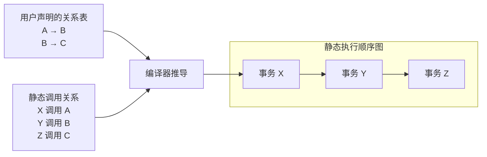

# pyCircuit 核心抽象设计

本文定义 pyCircuit 的核心抽象及其语义，包括基本变量、基础组件、Rule、Module、同拍顺序、EHR 可见性，以及基础静态执行图与 runtime if 升级版的编译记录。这些语义贯穿 ACPy 前端、ACIR 和 GFSim 后端。

文中的 Python 写法展示 ACPy 如何表达这些抽象，GFSim 表示说明后端如何承载它们。本文记录目标设计与待确定内容，不表示当前编译器已经实现全部功能。

array 的构造、选取、有效性及编译规则由正式的 [array 设计](array-design.md)定义，替代旧数组表达。

## 1. 基本变量与基础组件

pyCircuit 区分普通变量 `var` 与具有固定身份的基础组件 `Cell`、`Queue`、`Signal`。Cell 和 Queue 保存跨周期状态；Signal 按 BSV Wire 语义表达本拍有效的信号，不保存跨周期值。

| 类型 | 含义 | GFSim 中的表示 |
| --- | --- | --- |
| `var` | 组合逻辑计算产生的临时值 | 临时变量，不保存跨周期状态 |
| `Cell` | 寄存器状态，读取旧值，获准写入下拍生效 | 显式状态对象，保存旧状态 |
| `Queue` | FIFO 消息状态，通过 pop／push 消费和生产消息 | 显式状态对象，保存队列内容 |
| `Signal` | 本拍写入后有效，无有效写入时不可读取 | 显式组件对象，保存本拍 payload 与 valid |

基础组件的操作**本质上也是 Rule**，具有 guard、计算和效果，并通过关系表规定操作之间的先后顺序。

### 1.1 var：直接书写组合计算

`var` 直接通过普通表达式、局部赋值和控制流表达组合计算：

```python
total = lhs + rhs
ready = enabled and total != 0
if ready:
    result = total + 1
else:
    result = 0
```

这些值是本拍临时 SSA 值，不需要声明状态对象；类型直接写 ac.u32 等 payload 类型，删除 ac.var/ac.ref 包装。跨周期保存值需使用状态组件。

普通 helper 只处理显式传入的 payload，不接收组件或 Module 引用，不隐式访问状态，不调用 Rule。
类型和位宽严格匹配，字面量按上下文定宽；不提供通用转换或隐式截断、扩展。
条件必须为 bool，循环仅接受静态展开；禁止链式赋值、嵌套声明及未知／多余参数。

### 1.2 Cell

```python
state = ac.cell[ac.u32](initial=0)
```

| 操作 Rule | ACPy 表达 | 语义 |
| --- | --- | --- |
| read | `value = state`，或在普通值表达式中使用 state | 读取周期开始的旧值 |
| write | `state = value`，或 Rule 的 Cell 输出 | 提出写入，获准后下拍生效 |

Cell 必须有初值。已声明 Cell 在赋值左侧时表示 write，保持状态对象身份；新局部变量接收其 payload。传给 Cell 类型参数时保留状态对象引用；作为 Module 输出目的地时保持原对象，绑定获准写入。

即使同一事务已经提出 write，read 仍读取旧值。字段或数组元素赋值表示所属 Cell 的状态更新。

首版 Cell 操作暂按 CF 参与顺序分析，不因 Cell 访问建立同拍依赖边；获准写入在下周期统一提交。同一 Cell 同拍多个有效写入时不保证结果，不自动仲裁。

这一简化不保证 BSV 的 “one rule at a time” 串行化等价性：多个事务可以同时读取周期开始的快照并写入不同 Cell，其结果不一定等价于逐个执行事务。Rule 内部的原子性仍然成立。

### 1.3 Queue

```python
q = ac.queue[ac.u32](capacity=2, initial=[1, 2])
```

省略 capacity 时为 1；省略 initial 时为空。标量初值表示一个元素，序列初值表示初始 FIFO 内容。

| 操作 Rule | ACPy 表达 | 语义／默认条件 |
| --- | --- | --- |
| peek | `q.peek()` | 读取旧队头，要求非空，不消费 |
| pop | Rule 主体中将 q 用作普通值 | 读取旧队头并提出消费，要求非空 |
| push | `q = value`，或 Rule 的 Queue 输出 | 提出写入，要求有空间 |
| empty | `q.empty()` | 查询旧状态是否为空，不消费 |
| full | `q.full()` | 查询同拍容量视图，不消费 |
| size | `q.size()` | 查询旧状态元素数，不消费 |

Rule 主体中普通值读取默认提出 pop；显式 peek、Module 组合读取及 guard 中的读取只观察。传递 Queue 引用不消费。同一事务对同一 Queue 的重复消费合并为一次。

Queue 的操作顺序为 `peek → pop → push`。其内部 `full` 信号采用 EHR 机制，让 push 能观察前序获准 pop 释放的空间。具体机制在后续章节说明。

新 push 数据下拍可读，空 Queue 不提供同拍数据旁路。Queue 不提供 revise，也不通过 payload 赋值修改已有消息。

### 1.4 Signal

```python
signal = ac.signal[ac.u32]()
```

| 操作 Rule | ACPy 表达 | 语义 |
| --- | --- | --- |
| get | `value = signal`，或在普通值表达式中使用 signal | 隐式 guard 为 valid，读取本拍可见值，不消费 |
| set | `signal = value`，或 Rule 的 Signal 输出 | 提出本拍写入，使信号有效，保持资源身份 |

Signal 不声明初值。每拍开始为 invalid；只有本拍有效 set 后才可读取，下一拍重新为 invalid。get 不消费，允许多个读取者；valid 为 False 时 payload 不可使用。

已声明 Signal 在赋值左侧时表示 set；新局部变量接收其 payload。传给 Signal 类型参数时保留组件引用；作为 Module 输出目的地时保持原对象，绑定获准 set。

组件关系遵循 BSV Wire：

| 操作关系 | 契约 |
| --- | --- |
| set → get | SBR：严格同拍先后，不能在同一原子事务中对同一 Signal 同时 set 和 get |
| set 与 set | C：冲突 |
| get 与 get | CF：无冲突，不消费 |

get 读取前序获准写入；生产者失败，其 set 无效。嵌套调用也按外层事务检查上述关系，不提供同事务临时写入旁路。

GFSim 中的对象存储只是承载本拍信号求值结果。RTL 中 data 和 valid 对应组合信号，valid 来自本拍有效写入条件，不因为仿真每拍清除有效性而生成寄存器。

基础组件在定义上也是 Module，具备 Module 的所有特性（详见后续 Module 章节）。因此，未来开发中复用率高的 Module 可以沉淀为基础组件。

## 2. Rule

### 2.1 定义与职责

Rule 可以具有参数、guard 和返回值，包含组合计算、控制流及状态读取或修改。ACPy 使用 `@ac.rule` 修饰 `def` 定义 Rule。

首版要求显式标注所有参数和返回类型；无返回值时标注 `-> None`，不推断省略的接口类型。

`@ac.rule(public=False)` 声明私有 Rule，只允许本 Module 的主体和 Rule 直接调用；外部 Module 可以通过公开 Rule 间接使用。默认 `public=True`。公开性只控制访问权限，不改变 guard、事务或调度语义，也不表示自动参与调度。

状态访问通过调用基础组件的操作完成，这些操作本质上也是 Rule。Rule 也可以调用其他 Rule，组合它们的计算与状态操作。

**Rule 实际执行路径上的所有操作构成一个原子整体：要求全部成功，否则不产生任何状态修改。** 嵌套调用的 guard 和状态效果归入外层 Rule，不单独提交；未执行分支中的操作不参与本次执行。

Rule 可直接操作本 Module 声明的资源，以及通过 Module 接口或 Rule 参数显式绑定的资源。其他 Module 的未绑定资源，只能通过其公开 Rule 访问。这些跨 Module 调用仍属于调用者的同一个原子事务。

### 2.2 只读与状态修改

| 类别 | 行为 |
| --- | --- |
| 只读 Rule | 观察状态、进行组合计算、返回普通值，不产生状态效果 |
| 状态修改 Rule | 可以产生状态效果，包括 Queue 消费、写入状态对象等 |

分类由编译器根据直接操作及嵌套调用的效果推导，无需前端声明。调用状态修改 Rule 的外层 Rule，也属于状态修改 Rule。只查询 Queue 状态不构成修改；提出 pop 则构成修改。

### 2.3 调用与事务边界

| 调用上下文 | 语义 |
| --- | --- |
| Module 主体调用只读 Rule | 进行组合求值，不建立事务；求值条件沿返回值的依赖传播 |
| Module 主体选择状态修改 Rule | 建立一个独立事务 |
| Rule 内调用 Rule | 组合进外层调用；若存在状态效果，归入同一个外层事务 |

独立事务包含实际路径上的所有状态效果，包括直接状态访问及嵌套调用产生的效果。事务获准后全部效果按对应组件语义生效，否则全部取消。

嵌套 Rule 不单独获准、提交或取消。被调用不等于效果已经提交。

### 2.4 Guard 与条件传播

Rule 支持 `guard=`，缺省为 `True`。guard 可以是布尔变量，也可以是接收对应调用参数并返回 bool 的函数。guard 只观察状态，不消费或修改状态。

独立事务的完整执行条件来自：

- Module 选择该 Rule 的控制流路径。
- Rule 自身的 guard。
- 实际调用路径上嵌套 Rule 的 guard。
- 实际组件操作的默认就绪条件。
- 求得参数及控制条件所需的只读调用条件。

嵌套调用的 guard 传播到外层事务。分支中的要求只约束执行该分支的路径；未执行分支中的调用不增加要求。

Module 中只读 Rule 的求值条件，沿返回值的数据与控制依赖传播到使用它的 Rule，不影响无关 Rule。例如：

```python
value = component.read()  # 只读 Rule，guard 为 ready。
send(value + 1)           # 执行条件包含 ready。
independent()            # 不依赖 value，不继承 ready。
```

如果返回值决定分支，两条分支都以该值能够求得为前提。guard 失败不能作为条件为假而进入 else。

普通计算值不增加持久 valid 状态，也不默认使用旧值。

### 2.5 参数、返回值与状态连接

Rule 可以接收基础组件引用和普通 payload；Module 实例依赖只通过 __init__／__call__ 静态绑定，不直接作为 Rule 参数。组件类型参数接收对象引用，普通值类型参数接收 payload；传递对象引用本身不触发读写。状态对象引用的直接访问遵循 Module 的访问边界；普通 var 表示组合计算值，不保存跨周期状态。

Rule 主体中的赋值语法糖如下，左侧组件必须已被识别为固定对象：

| 组件 | 组件在赋值左侧 | 在普通值表达式中使用 |
| --- | --- | --- |
| Queue | push | 读取队头并提出 pop |
| Cell | write | read |
| Signal | set | get |

普通局部变量赋值表示组合计算。Queue 只观察时显式使用 peek；guard 中的读取始终只观察。同一事务对同一 Queue 的重复消费合并为一次。语法糖不改变组件的 guard、原子性和同拍可见性。

| 返回形式 | 含义 |
| --- | --- |
| 普通 var | 返回本次调用的组合计算结果，供只读求值或同一事务内的调用者使用 |
| Queue／Cell／Signal 输出 | 返回 payload，绑定为事务对固定资源的 push／write／set 效果 |
| None | 无返回值，可以直接操作组件 |

返回类型决定 return 的含义。组件类型输出返回 payload，由调用处绑定固定资源，不在运行时分支中创建新对象。例如：

```python
@ac.rule
def transfer(source: ac.queue[ac.u32]) -> ac.queue[ac.u32]:
    return source + 1

out = transfer(input_queue)
```

这个调用对输入提出 pop，对固定输出 out 提出 push。return 结束当前调用路径，不单独提交效果；包括嵌套调用输出在内的所有效果，随外层原子事务整体获准或取消。

**独立调度的 Rule 之间只能通过组件对象（Queue、Cell、Signal 等）传递数据，不能直接传递普通 var。**

组件对象构成固定连接，数据通过组件操作传递。同时允许：

- Module 的组合计算结果、只读 Rule 的求值结果作为事务入口 Rule 的实参。
- 同一事务内的嵌套调用，通过参数与返回值传递普通 var。

因此，一个独立事务产生的普通返回值，不能直接用作另一个独立事务的输入。

### 2.6 Signal 的有效性与条件传播

Signal 的 get 带有隐式有效性条件。消费者依赖本拍有效写入；没有有效写入时，get 失败，使用该读取的事务不能 fire，不回退到上一拍值。

`set → get` 要求先确定前序生产者的事务结果，再判断消费者。生产者的成功通过 Signal.valid 约束消费者，不需要在前端复制生产者的 guard。

Module 主体读取 Signal 时，get 的有效性条件沿数据与控制依赖传播到相关 Rule；invalid 不能当作数值零或布尔 False，也不能因此进入 else。普通局部 var 本身不增加持久 valid 状态。

嵌套调用写入 Signal 不获得独立提交能力；其 set 效果随外层事务一起提交或取消。

### 2.7 示例

```python
@ac.module
class Counter:
    def __init__() -> None:
        count = ac.cell[ac.u32](initial=0)

    @ac.rule
    def read() -> ac.u32:
        return count

    @ac.rule
    def write(value: ac.u32) -> None:
        count = value

    @ac.rule
    def advance() -> None:
        value = read()
        write(value + 1)

    def __call__() -> None:
        advance()
```

`read` 是只读 Rule；`write` 和 `advance` 是状态修改 Rule。Module 选择 `advance` 建立独立事务，其内部调用不建立新事务。`read` 返回普通值，`write` 的状态效果归入 `advance`，获准后按 Cell 语义下拍生效。

## 3. Rule 关系与执行顺序图

### 3.1 用户声明的关系表

同一个 Module 可以显式声明其 Rule 之间的相对关系。这些声明构成 Module 的局部契约，可抽象为一张关系矩阵；关系含义对齐 BSV 的 CF、C、SB、SBR。

| 关系 | 含义 |
| --- | --- |
| CF | 无冲突，不施加顺序，允许在同一事务中组合 |
| C | 冲突，不能同时使用，也不能在同一事务的实际路径上组合 |
| SB | 普通先后，允许在同一事务中组合 |
| SBR | 严格先后，不能在同一事务的实际路径上组合 |

**本文的 Rule 先后关系均指同一拍（同一 tick）内的处理顺序。** `A → B` 表示同拍涉及 A、B 的调用时，先处理 A，再处理 B，不表示 B 在下一拍执行。它不要求 A 必须被调用或成功，也不让 B 继承 A 的 guard。

例如，用户声明 `A → B`、`B → C`：

|  | A | B | C |
| --- | --- | --- | --- |
| A | — | SB | — |
| B | — | — | SB |
| C | — | — | — |

矩阵中的关系表示**行项操作相对于列项操作的关系**。例如 A 行、B 列的 SB 表示 A 先于 B。

该例使用 SB；需要禁止同事务组合时声明 SBR。`—` 表示未声明关系，不表示 CF。

**声明表只保存用户显式声明的关系。** 传递关系及调用传播的结果不补写进这张表。

### 3.2 编译器推导的执行顺序图

其他 Rule 调用这些子 Rule 时，编译器根据声明表与实际调用，将顺序约束向外层传播。调用者来自 Module 内部或外部，推导方式相同；多层嵌套调用继续向外传播。

以上述声明表为例：

| 调用者 | 调用的子 Rule |
| --- | --- |
| X | A |
| Y | B |
| Z | C |

若 X、Y、Z 属于三个独立事务，编译器推导执行顺序：

```text
X → Y → Z
```

传递关系在执行顺序分析中处理。编译器还保留：

- 实例身份：同名 Rule 属于不同实例时，不仅因名称相同而建立关系。
- 事务归属：SB 允许同属一个外层事务，约束内部调用顺序；SBR 和 C 禁止在同一外层事务的实际路径上组合，包含嵌套调用。属于不同事务时，SB／SBR 形成顺序边，C 形成冲突约束，CF 不增加顺序边。

这些边共同构成 Rule 执行顺序图，供同拍调度与代码生成使用。runtime if 的分支记录与本版无环约束见 6.2 节。

### 3.3 顺序与状态可见性

顺序关系决定谁先处理；后者能否看到前者的写入，由状态组件的可见性语义决定。例如 Cell 仍读取旧值，Signal 可读取前序获准写入，EHR 按阶段提供可见性，Queue 按自身契约处理容量变化。

**用户声明的关系表是输入契约，执行顺序图是编译器的派生结果。** 同拍执行顺序与竞争时谁优先获准是不同概念，SB／SBR 不规定仲裁优先级。关系通过 @ac.rule(SB=..., SBR=..., C=..., CF=...) 声明。首版不自动仲裁。

## 4. Module

Module 声明状态对象、子 Module 实例和 Rule，主体书写组合计算与控制流，并通过控制流选择调用 Rule。ACPy 使用 `@ac.module` 修饰 class，使用 `@ac.rule` 修饰成员函数。

### 4.1 构造与主体逻辑

| 位置 | 职责 |
| --- | --- |
| `__init__` | 接收参数化 config，声明内部组件与子 Module 实例 |
| `@ac.rule` 成员函数 | 表达组合计算、控制流、状态操作及嵌套 Rule 调用，保持原子事务语义 |
| `__call__` | 绑定接口，表达组合计算、控制流及 Rule 调用，把 Rule 输出绑定到调用者明确声明的目的地 |

首版三者的所有参数及返回类型都必须显式标注，无返回值写 `-> None`；`__init__` 返回类型为 None。连接后的接口类型推断留待后续实现。

`__call__` 可省略。只提供状态和公开 Rule 的组件在实例化后即可被调用，例如寄存器文件和数据内存；
不需要定义空主体或额外写 `rf()`。没有主体的实例不独立选择或自动调度 Rule，嵌套调用仍属于调用者的事务。
需要固定接口或每拍主体逻辑的 Module 才定义 `__call__`。状态观测由执行轨迹提供，不要求额外导出内部状态。

`__init__` 只表达静态构造，config 用于位宽、容量、初值等配置。运行时分支不创建组件或子实例；运行时计算写在 `__call__` 或 Rule 中。

状态对象的声明位置不代表独占写入权限；其他 Module 可以通过公开 Rule 访问或修改这些状态。

### 4.2 隐式作用域与固定连接

成员函数省略 `self` 参数，访问当前实例的对象时也省略 `self.`。构造配置、声明的组件、子实例及成员 Rule，在当前 Module 内可见。

- `update(...)` 表示调用当前实例的 Rule；`child.read(...)` 表示调用指定子实例的公开 Rule。
- 普通局部变量表示组合计算，不因为位于 class 中就成为持久状态。
- 对已声明状态对象的赋值，按对应组件语义表达状态操作，保持对象身份。

这是由 ACPy 编译器解析的 DSL。编译器建立隐式实例作用域，不依赖普通 Python class 自动提供这种名字查找行为。

先通过构造函数实例化。有 `__call__` 接口的实例通过它建立固定连接，每个实例只绑定一组编译期固定连接，
不在运行时重新绑定；没有 `__call__` 的实例直接使用其公开 Rule。
连接通过 `out = stage(source, ...)` 或显式组件参数表达，输出对象由父 Module 预先声明。

- `__call__` 入参可以是 Queue、Cell、Signal 等组件引用，也可以是其他 Module 实例。实例参数用于调用其公开 Rule，传入实例本身不建立执行顺序。
- `__call__` 的组件／组件元组返回类型声明输出接口；主体返回 Rule 的输出，绑定到赋值左侧的已声明目的地，不返回内部组件引用。Module 不返回跨独立事务传递的临时 var。
- 输出组件必须明确声明，位宽、容量、初值等配置由该声明决定；不根据返回类型自动生成组件。条件化 return／None 仅提出所选路径的输出效果。
- 父 Module 声明的组件作为端口参数传入或绑定为输出目的地，确定共享连接；子实例内部未绑定的状态通过公开 Rule 访问，不维护输出列表。
- 显式资源绑定确定访问范围，不改变对象归属和组件操作契约。读取时获取对应语义下的可见值，不在连接时复制一次 payload。

不再使用 `.outputs` 列表或把内部状态作为 `__call__` 返回引用导出；内部状态由逐拍轨迹观察。
`out = stage(...)` 保持 out 的对象身份，输出效果归入产生该值的 Rule 事务，不增加独立的搬运事务。

### 4.3 示例

下面省略具体解码和执行算法，展示完整的接口形式：

```python
@ac.module
class ID:
    def __init__(width: ac.u32 = 32) -> None:
        ...

    @ac.rule
    def decode(
        source: ac.queue[Fetched],
    ) -> ac.queue[Operands]:
        ...

    def __call__(
        source: ac.queue[Fetched],
        rf: RegisterFile,
    ) -> ac.queue[Operands]:
        return decode(source)


@ac.module
class EX:
    def __init__() -> None:
        ...

    @ac.rule
    def execute(
        source: ac.queue[Operands],
    ) -> ac.queue[Result]:
        ...

    def __call__(
        source: ac.queue[Operands],
    ) -> ac.queue[Result]:
        return execute(source)
```

在顶层 Module 中先声明流水线 Queue 和实例，再连接：

```python
def __init__() -> None:
    if_id = ac.queue[Fetched]()
    id_ex = ac.queue[Operands]()
    ex_mem = ac.queue[Result]()
    rf = RegisterFile()
    id_stage = ID(width=32)
    ex_stage = EX()

def __call__() -> None:
    id_ex = id_stage(if_id, rf)
    ex_mem = ex_stage(id_ex)
```

对应固定连接：

```text
IF_ID → ID → ID_EX → EX → EX_MEM
         └── 调用 RF 的公开 Rule
```

ID_EX 和 EX_MEM 由顶层明确声明，Rule 输出绑定到对应 Queue；Module return 不导出引用，
不额外提出第二次 push，目的地容量要求参与原 Rule 的完整条件和原子取消。

### 4.4 编译处理

1. 只在 `__init__` 构造实例和组件，收集全部 __init__／__call__ 静态绑定后再展开行为；允许固定引用互相绑定，禁止递归行为展开。
2. 将隐式名字解析为具体实例的资源、子实例或 Rule。
3. 分析 Rule 的 guard、组合计算、状态操作及嵌套调用。
4. 将 `__call__` 的路径条件、参数计算及共享计算关联到相关事务入口，保留共享依赖。
5. 根据组件契约、用户声明的 Rule 关系及实际调用，推导同拍执行顺序图。

运行时 if 中调用子 Module 时，源层保留 module.call。编译器携带父路径条件及其有效性进入子主体，约束内部各事务，保持固定连接，不创建 Module 级原子事务。条件可以来自其他 Module 的只读 Rule，仍引用原 SSA 和固定状态视图；读取失败不能作为 False 进入 else。

Module 主体不作为独立的运行时调度单元。`__call__` 是前端主体逻辑的容器，不生成独立调度的 Module Work；其中的 if 形成调用路径条件，合并到相关 Rule 的执行条件中。换成 class 不改变已有的原子事务、状态可见性和 Rule 调度语义。

### 4.5 组合计算与控制流的 Lower

Module 主体保留共享计算，将路径条件和参数绑定到 Rule 事务入口。例如：

```python
def __call__() -> None:
    x = source.read() + 1

    if enabled:
        send(x)

        if audit_enabled:
            y = checker.read()
            audit(x, y)

    independent()
```

假设 `source.read()`、`checker.read()` 是只读 Rule，其余调用是状态修改 Rule。组合计算生成 SSA 节点，嵌套 if 保留控制结构；编译器记录以下事务入口：

| 事务入口 | 选择条件 | 参数绑定 | 求值依赖 |
| --- | --- | --- | --- |
| send | enabled | x → %x | source.read() |
| audit | enabled && audit_enabled | x → %x，y → %y | source.read()、checker.read() |
| independent | True | 无 | 无 |

- `x` 只生成一份计算，两个入口共同引用，不要求将计算搬进 Rule 函数体。
- 读取涉及 EHR 时，先确定读取操作对应的固定端口；其前序写入依赖传播到所有使用该值的入口，共享计算在这些写入的本拍结果确定后求值。
- 从入口的选择条件和参数追溯依赖，将相关只读调用的 guard 合并到入口条件，再与 Rule 实际路径上的内部要求合并。选择条件本身依赖的读取也按此处理。
- 条件只影响相关事务：`checker.read()` 不就绪只阻止 audit；`source.read()` 不就绪阻止 send 和 audit，均不影响 independent。读取失败不作为条件为 False。
- 根据组件操作契约推导同拍顺序与冲突，不按源码书写顺序调度。send 与 audit 是独立事务，嵌套 if 不表示 audit 依赖 send 成功。

### 4.6 名字遮蔽

参数、已绑定的局部变量优先于同名 Module 成员。对未被局部变量遮蔽的组件成员赋值表示组件写入；
可用显式局部类型声明建立同名局部变量，此后的赋值与读取均作用于该局部变量。

## 5. EHR：同拍有序可见的状态寄存器

EHR 的端口契约对齐 BSV CReg。它保存跨周期状态，并支持后序事务在同拍观察前序获准写入。用户可以显式声明 EHR，编译器根据访问它的 Rule 顺序安排读写端口。

### 5.1 操作与可见性

| 操作 Rule | 语义 |
| --- | --- |
| read | 返回当前端口可见的值 |
| write | 提出当前端口的状态写入 |

端口 `p` 的 read 可以观察编号小于 `p` 的获准 write；存在多个前序获准写入时，读取端口编号最大的那次写入。没有前序获准写入时读取旧值。同端口 write 不对 read 可见。

| EHR 操作关系 | 契约 |
| --- | --- |
| 同端口 read 与 read | CF |
| 同端口 read → write | SB，允许同一事务读旧值并写入 |
| 同端口 write → write | SBR，不允许同一事务重复写该端口 |
| 低端口的 read／write → 高端口的 read／write | SBR，不允许同一事务访问该 EHR 的不同端口 |

没有顺序关系时，不额外建立写入可见性。EHR 不统一规定 write 先于 read，具体端口由调用者的顺序决定。

上述限制按外层原子事务检查，包含嵌套调用；不提供同事务跨端口临时写入旁路。获准写入中端口编号最大的写入决定下拍保存值；本拍没有获准写入时保持旧值。

### 5.2 示例：Queue 的 `pop → push`

以容量为 1 的 Queue 为例，其内部 `full` 是一个 EHR。pop 和 push 分属不同外层事务；其跨端口关系为 SBR。根据 `pop → push`，编译器安排：

| Queue 操作 | EHR 操作 | 端口 |
| --- | --- | --- |
| pop | 获准消费后写入 `full = False` | 0 |
| push | 读取 full，判断是否有空间 | 1 |
| push | 提出写入时写入 `full = True` | 1 |

旧 full 为 True 时，获准 pop 在端口 0 写入 False，push 在端口 1 就能读到 False，从而同拍写入。

若 pop 未获准，其写入无效，push 仍读取旧 full，不能执行。新 push 数据仍然下拍可读。

**Rule 顺序规定谁先处理，EHR 端口规定后者能够观察哪些写入。**

### 5.3 Module 中的 EHR 读取

Module 中的读取使用被调用操作对应的固定 EHR 端口，不随使用该值的 Rule 重新分配端口。同一次读取产生的值由所有使用者共享；不同 tick 的值可以不同。

编译器将该端口的前序写入依赖传播到相关事务入口。在这次读取首次求值前，所有可能影响它的前序写入事务必须已确定本拍是否 fire；获准写入按端口规则可见，未获准写入不产生效果。

例如 Module 中 `x = storage.read()` 被 A、B 使用，read 对应端口 1，W 写端口 0，则执行图包含 `W → A`、`W → B`。先确定 W 的结果，再求得 x，A、B 使用同一个值。

代码生成必须遵守这一求值顺序，不能在每拍开始时提前计算所有 Module 逻辑。读取依赖形成同拍环时，按本版无环约束拒绝编译；不新增独立的 Module Work。

## 6. 编译产物：静态 Rule 执行顺序图

编译器根据静态实例、Rule 调用关系和用户显式声明的关系表，生成一张**静态 Rule 执行顺序图**。

**图中的先后约束均为同拍顺序，不表示跨拍延迟。** 状态何时可见、何时成为下拍状态，由对应组件的语义决定。

- 节点：独立事务入口 Rule，关联其 guard、组合计算和状态操作。
- 边 `X → Y`：表示同拍处理 X、Y 时，X 必须先于 Y；不要求 X 成功。
- 嵌套调用：归入外层事务，其顺序约束沿调用关系向外传播。

用户声明表只保存显式关系，推导结果保存在执行图中。

### 6.1 基础版本与示例

用户声明 `A → B`、`B → C`；X、Y、Z 分别调用 A、B、C：



图在编译期确定，不随 tick 改变。图无环时，可以预先生成拓扑执行顺序；每拍按该顺序处理，各事务是否执行由自身执行条件决定。

最简单的执行方式是每拍遍历所有事务入口，检查完整 fire 条件；满足时执行整个原子事务，否则不产生状态修改。

带激活的执行方式是：

1. 将本拍初始激活的 Rule 放入候选集合。
2. 按静态拓扑顺序处理候选，检查完整 fire 条件。
3. fire 成功后发布同拍可见效果，将后继加入候选；失败则停止本次传播，其他候选继续处理。

候选集合合并重复激活，每个 Rule 本拍至多处理一次。前驱失败不阻止后继通过初始集合或其他路径被激活。初始集合必须覆盖需要独立尝试的 Rule，其产生方式另行确定。

### 6.2 runtime if 的编译记录

图节点仍是独立事务入口 Rule。编译器为每个 Rule 的可能执行路径编号，不枚举整个系统的全局分支组合；嵌套调用的关系与效果归入外层事务。

每个分支记录汇总判断条件和后继表：

| 信息 | 内容 |
| --- | --- |
| 汇总判断条件 | 路径选择条件、Rule guard、实际调用的子 Rule 及基础组件操作的就绪条件 |
| 后继表 | 目标 RuleId 及关联的目标分支集合 |

判断条件关联生成的判断逻辑，其中包含求值所需的组合计算。实际计算和状态操作由 Rule 的生成代码承载。读取依赖、调用摘要和 EHR 端口分析用于编译，不在分支表中重复保存。

后继表示例：

| 源 Rule | 源分支 | 目标 Rule | 关联的目标分支集合 |
| --- | --- | --- | --- |
| X | X₀ | Y | Y₀、Y₂ |
| X | X₀ | Z | Z₁ |
| X | X₁ | Y | Y₁ |

第一行表示 X 选择 X₀、Y 选择 Y₀ 或 Y₂ 时，存在同拍顺序 `X → Y`。源 Rule 和源分支由所属表确定；每条记录只需保存目标 RuleId 和目标分支集合，前驱索引反向生成。目标分支集合可用列表或位图表示。

**本版将所有分支的同拍顺序关系合并到 Rule 节点级图中，并要求合并图无环。存在环时拒绝编译，即使实际分支组合可能无环。** 该限制表示本版不支持这种分支相关顺序，不代表运行时必然有环。检查仅针对不同独立事务之间的同拍顺序边，跨拍状态反馈不因此判环。

编译器保存合并图及适用于所有分支的固定拓扑顺序。运行时分支决定实际调用、状态效果和激活传播，不改变该拓扑顺序。

### 6.3 自动仲裁（初版可考虑不实现）

自动仲裁参考 BSV：编译期根据组件操作契约和实际调用分析 Rule 冲突，确定竞争优先级；每拍由生成的组合控制逻辑检查条件，选择获准执行的 Rule。

- `CAN_FIRE`：Rule 的选择条件、guard 及实际操作的就绪条件满足。
- `WILL_FIRE`：Rule 最终获准执行，整个事务的效果由它统一控制；未获准则不产生效果。

用户可指定竞争优先级；若由编译器自行选择，应给出警告。**竞争优先级决定选谁，同拍执行顺序决定获准者之间的顺序。**

初版可不实现自动仲裁，由用户显式书写选择逻辑。没有端口竞争时可将 CAN_FIRE 与 WILL_FIRE 合并为一个 fire；出现未处理的端口竞争时不保证结果。
