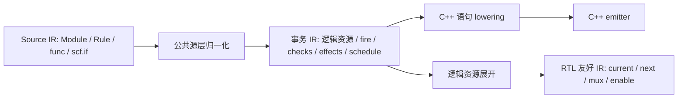

# C++ lowering 与生成代码审阅

此次重构从事务 MLIR 生成按事务组织的 C++ 语句；公共 fire、契约、端口和 schedule 仍是唯一执行依据。
实现入口是 `mlir/CppLowering.cpp`、`mlir/CppEmitter.cpp` 与 `mlir/ResourceExpansion.cpp`。
源名用 `acir.bind`／块参数的 NameLoc 保存，辅助函数展开保存 CallSiteLoc；名称不参与语义判断。

2026-10-15 的后续调整同时修改源层和事务层，入口另含 `Optimizations.cpp`、
`Transactions.cpp` 与 `BooleanConditions.cpp`。不再只从最终 C++ 文件长度判断可读性。



Source IR 不保存 C++ 语句或缓存，优化后的源文件可独立重载、重新提取事务并 lower 到 RTL。
源层只整理名称、常量和结构分支；Module 主体内静态调用点始终保留。事务提取直接处理
scf.if 的区域合流，参数不再重复附加整条调用路径；保留无环 CFG 独立输入的转换能力。
初始化表达式的 IR 解释执行同样支持结构分支。

## BSC 参照

本地参考文件位于仓库 `reference/bsc/src/comp/`，下载日期与 SHA256 保存于
`reference/bsc/reference-manifest.json`。
[SimMakeCBlocks.hs](https://github.com/B-Lang-org/bsc/blob/main/src/comp/SimMakeCBlocks.hs)
按模块建立 rule_fns，并以 cvtARule 转换 Rule；
[SimCOpt.hs](https://github.com/B-Lang-org/bsc/blob/main/src/comp/SimCOpt.hs)
的 moveDefsOntoStack 分析定义的函数使用范围，将合适的定义移至局部；
[SimBlocksToC.hs](https://github.com/B-Lang-org/bsc/blob/main/src/comp/SimBlocksToC.hs)
承载 C++ 输出及可直接使用的字面量／表达式。
本实现采用这些代码组织原则，保留原来的静态调度及统一拍末提交。

还实际编译了 `builds/benchmarks/bsc-readability/FetchDemo.bsv`，使用 BSC 2026.07.1
的 ARM64 发布包，版本、命令和校验和在同目录 `comparison-info.json`。生成文件
`mkFetchDemo.cxx` 的 Rule 主体如下节选（省略其 packed payload 拼接）：

```cpp
void MOD_mkFetchDemo::RL_fetch() {
  tUInt8 DEF_index__h317;
  tUInt32 DEF_pc_PLUS_4___d8;
  DEF_pc___d2 = INST_pc.METH_read();
  DEF_index__h317 = (tUInt8)((tUInt8)7u & (DEF_pc___d2 >> 2u));
  // rom.sub(index) 和 packed payload 拼接
  DEF_pc_PLUS_4___d8 = DEF_pc___d2 + 4u;
  INST_outputQ.METH_enq(DEF_pc_CONCAT_rom_sub_pc_BITS_4_TO_2___d7);
  INST_pc.METH_write(DEF_pc_PLUS_4___d8);
}
```

调度文件先计算 CAN_FIRE／WILL_FIRE，再调用该函数。BSC 也会改写名称、打包结构，
值得借鉴的是模块、Rule 函数、局部定义与状态方法之间清晰的边界。本项目将相同边界
放在 `try_fetch()` 等具名入口内部，调用顺序仍由公共 schedule 决定。
这里是可比 fetch 规则的组织方式对照，不是完整 CPU 等价性或 BSC 性能比较。

## 条件、计算与效果

事务内部的普通局部值按数据依赖排序。布尔选择／短路向可能失败的操作传播需求；
编译期布尔决策图合并需求路径，使同一区域内的值只生成一次。已知非零常量除数、
已证明界内的索引和不改变固定读取视图的纯计算可以提前计算；断言、非法坐标、
可能除零及会改变读取视图的共享边界保留条件。成功 fire 后分别准备全部效果参数，
最后集中发布 Cell／Queue／Signal／EHR 操作；取消不会发布部分写入。

公共条件归一化以布尔决策图消除重复条件，验证可能失败的计算和共享可变读取的需求路径；
不能证明时保留原式。断言以原需求使能形成 `fire ... checks(...)`，成功后才可将其结果
用于布尔简化；后续容量阻塞 fire 不会漏掉此前应执行的断言。原生 verifier 要求检查依赖
只能返回 true 或抛断言错误，独立事务／RTL 重载同样验证。两个执行后端都先求值这些依赖。

按使用次数保留复用的结构值，使解码保留 `Decoded inst` 和 `inst.rd/rs1/rs2` 字段；
不按名称决定优化。源绑定只附着最终结果，编译器增加的索引、界限和 ready 值不再误用
`word` 等源变量名。C++ 生成复用成功 fire 的事实，消除效果阶段重复的检查、恒真使能和
空准备块；只有候选资源集合可能重合的多个 pop 才生成运行时去重集合。

对跨事务使用的值，只缓存离开共享区域的输出和共享读取快照。共享读取 data/ready
放在同一计算块；Model 的缓存是这些边界的 optional，不是逐 SSA 值的有效位表。
块内部是普通局部变量，拍首清空边界缓存。

## 流水线 CPU 的五个事务

逐个审阅 `builds/riscv_pipeline/cpp/model.hpp` 的五个具名 Rule 函数及 `tick()`：

| 原 Rule／函数 | 条件与局部计算 | 准备并发布的状态操作 |
| --- | --- | --- |
| fetch／try_fetch | PC、ROM 坐标和输出容量；保留 pc、word 等源名 | 更新 PC，并向 if_id 推送 Fetched；输出省略不新增搬运事务 |
| read_operands／try_read_operands | 解码 inst；根据 mem_wb 与 pending 的固定视图检查操作数；计算 lhs、rhs、store_value | 单次 registers／pending 动态索引，消费 if_id、推送 id_ex，并设置目的寄存器的 pending |
| execute／try_execute | id_ex 就绪、ex_mem 容量；根据 kind 计算 result | 消费 id_ex，推送字段具名的 Executed |
| access／try_access | ex_mem 就绪和 mem_wb 容量；LOAD／STORE 的地址断言只在实际路径执行 | 准备读结果或 words 更新，消费 ex_mem，推送 Retired |
| commit／try_commit | mem_wb 就绪；writes／rd 的条件计算 | 准备寄存器和 scoreboard 单次索引写入，消费 mem_wb，更新退休状态 |

`RegisterFile` 中 `registers` 与 `pending` 均为固定 Cell 数组；payload 使用 Fetched、
Decoded、Operands、Executed、Retired 及 pc／word／rd 等字段名。
函数归入原实例的结构体，嵌套 RF、memory helper 的效果仍由外层原子 fire 控制。
`tick()` 的调用次序直接对应公共 schedule，保留后级 Queue pop 为前级腾空间的规则。

## OoO 的分配、发射、广播与退休

逐个审阅 `builds/ooo_scheduler/cpp/model.hpp` 中相关 Rule：

| 原事务 | 条件与局部计算 | 状态操作与原子边界 |
| --- | --- | --- |
| dispatch.dispatch | message、ROB 空间和 RS 选取；命名 uop、tag、rd、Operand 值 | 消费输入，准备 ROB 分配、RF 重命名表和 RS 内容；失败取消整组效果 |
| scheduler.issue_add | 保留站有效、操作数 ready、kind 与选择路径、adder 输入容量 | 清空被选 RS，推送 Entry；属于外层发射事务 |
| scheduler.issue_mul | 同样按实际选择、MUL 条件和 multiplier 输入容量判断 | 被选 RS 清空与 MUL 入队一起发布 |
| cdb.broadcast | 在 ADD／MUL 完成结果之间选择；保持 Signal 有效性与共享视图 | 消费选中完成 Queue，更新 ROB done／value、唤醒 RS，并发布广播 Signal |
| commit.commit | ROB 队头有效并完成；按 tag／rd 计算写回和重命名释放条件 | 更新 RF registers、busy、tags；清空 ROB 头并推进顺序退休计数 |

adder.execute、multiplier.accept／advance 和 audit.observe 也保持独立具名函数与公共
调度位置。Completion、Operand、Entry、RobEntry 保留字段；RF 的三个 Cell 数组仍
以运行时坐标访问。ROB／RS 的异构实例按前端实例结构组织，没有改写为动态调度器。

## 验证与测量

最终回归、四模型逐拍轨迹、三阶段独立重载、raw／opt 对照、ASan／UBSan、reset、
生成结构检查和重构前后测量位于 `builds/benchmarks/cpp-structure-refactor/`。
`acceptance/summary.json` 将事务与 RTL 友好层标为 **IR interpretation（IR 解释执行）**；
C++ 为单独编译执行。独立 ISA、退休周期／顺序、原子取消、Signal、EHR、数组域、
短路与 reset 的预期仍由测试中的独立断言检查。

`comparison.json` 保存四个旧生成程序与最终优化版本的代码 bytes／lines、缓存字段数量、
C++ 编译秒数、10000 拍无轨迹耗时及五次运行中位数，另有生成文件 SHA256。
旧程序也与本轮 32 拍轨迹逐拍对上。计数只包含缓存字段，排除函数中的 return 引用。
使用本机 aarch64、Clang 22、C++20 -O1；时间含进程启动，部分验证并行，不视为隔离基准。
ASan／UBSan 验证设置 `ASAN_OPTIONS=detect_leaks=0`，本机 ptrace 环境不支持 LeakSanitizer。

组件数组的单选访问保留逻辑 index／domain／ports；RTL 在克隆 IR 上物理展开。
当前批量 mask 写仍采用逐候选条件效果，异构 Module 数组仍按实例分别生成结构体。
这两种操作没有被错误地当作同构 Cell 数组单选访问，也没有新增调度或公开前端 API。

2026-10-15 源层／条件优化的独立证据保存在 `builds/benchmarks/bsc-inspired-compiler/`。
`baseline/` 保留本轮开始时全部已存在的未提交改动和四模型产物；`comparison.json`
对比的是该基线与本轮最终产物。`structural-review.json` 逐 Rule 记录主体行数、fire 前
行数、布尔声明、断言和 pop 去重集合；不会把加入缩进当作语义简化的证据。
本轮测试新增 Source IR 独立 native RTL 管线、零结果分支断言、容量失败前断言及非法检查依赖验证。

本轮最终测量（与本轮开始的已重构基线比较）：

| 模型 | 总 bytes 前→后 | 缓存字段 前→后 | C++ 编译秒 前→后 | 10000 拍毫秒 前→后 |
| --- | ---: | ---: | ---: | ---: |
| array_arbiter | 79502→36760 | 10→6 | 1.24→1.10 | 2.31→2.14 |
| ehr_shared | 11062→10905 | 6→4 | 1.03→0.97 | 1.97→1.71 |
| riscv_pipeline | 93007→40475 | 2→0 | 1.43→1.18 | 3.35→2.81 |
| ooo_scheduler | 158330→75232 | 30→52 | 1.81→1.48 | 4.88→2.95 |

C++ 编译采用 Clang 22、C++20 -O1；运行时间为五次中位数，包含进程启动，验证并行且未隔离，不能据此保证性能倍数。
OoO 保留结构后共享边界增多，缓存字段从 30 增为 52；它们仍是共享输出／固定读取快照的 optional，不是全量 SSA 缓存。
四个保存的旧 C++ 程序与本轮全部 32 拍的状态和 fire 标签完全一致。

| CPU Rule | 主体行数 前→后 | fire 前行数 前→后 | 布尔声明 前→后 |
| --- | ---: | ---: | ---: |
| top.fetch.fetch#0 | 35→19 | 18→5 | 16→4 |
| top.decode_stage.read_operands#1 | 554→103 | 352→81 | 428→37 |
| top.execute.execute#2 | 30→14 | 14→2 | 13→2 |
| top.memory_stage.access#3 | 92→46 | 51→12 | 52→14 |
| top.writeback.commit#4 | 58→31 | 20→6 | 23→5 |

最终验证：66 项回归通过，CTest 1/1；四模型各 32 拍的 C++、事务 IR 解释执行和 RTL 友好 IR 解释执行一致，
raw／opt、三个阶段独立重载、ASan／UBSan 和 reset 通过。保存的旧 C++ 也与全部 state／fire 字段一致。
独立 ISA、退休周期／顺序、原子取消、Signal、EHR、动态数组与短路的已有独立预期继续通过。
生成示例已更新，且与本轮验证过的 C++ 文件逐字节一致。
