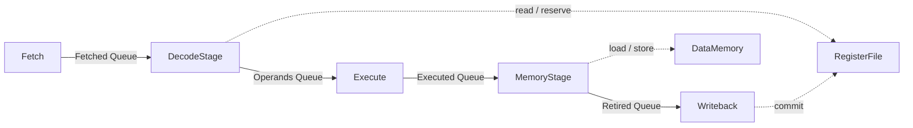
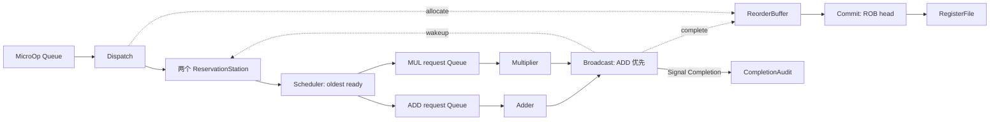

# 编程范式示例

这些文件是编译器的 Python AST 输入，用 `compile` 编译；不直接作为 Python 程序运行。示例展示静态实例、资源连接、rule 事务和 method 组合。测试验证 MLIR 与依赖分析，当前没有执行或仿真后端。

建议按下面顺序阅读。每个 Module 构造一个固定实例；其状态用 `instance.state`，返回连接用 `instance.outputs`。每个 rule 是一个事务，调用其它实例的 method 时，读取、guard 和修改仍属于这个事务。

Rule 在 Module 层定义，额外选择条件直接写成 Module 中的布尔计算和 `if` 调用。Queue read/pop 自动要求旧输入非空，返回 Queue payload 自动 push 并检查输出空间；组件 method 的 guard 随实际调用传播。源码不重复这些就绪条件。Router 和 Broadcast 直接调用 Rule，导出的 Signal 保存最新结果，读者等待写者判断；失败时读取保留值。

| 源码 / top | 重点 | 对应测试 |
| --- | --- | --- |
| [signal_link.py](signal_link.py) / `SignalLink` | method、自主 Rule、控制与跨 Module Signal 连线 | 赋值读写、保存结果、共享 guard/参数准备 |
| [mixed_ports.py](mixed_ports.py) / `MixedPorts` | Queue、Cell、Signal 混合输出；返回 None 省略效果；跨模块当前值读取 | 混合端口、原子效果、优化后输出重载 |
| [ehr_slots.py](ehr_slots.py) / `EHRSlots` | release→available→allocate 自动阶段；guard 看到获准 release，Cell payload 仍读旧值 | `test_ehr.py` 与示例优化重载 |
| [shared_state.py](shared_state.py) / `SharedState` | 两个互斥调用者共享一个实例，另一实例独立；method 参数保留消费角色 | 身份共享、互斥修改、重复读取只 pop 一次 |
| [dual_channel.py](dual_channel.py) / `DualChannel` | 两个 Rule 共用一次只读 method 和组合计算，条件调用 | 原始访问与调用身份、区域使用者、按需就绪 |
| [riscv_pipeline/model.py](riscv_pipeline/model.py) / `Pipeline` | 五级流水线、寄存器记分牌、数据存储器 | 五条 rule、固定端口、guard 观察、跨模块写入 |
| [ooo_scheduler/model.py](ooo_scheduler/model.py) / `OutOfOrder` | 重命名、两保留站、独立 ADD/MUL、完成广播、顺序提交 | 九条 rule、分支消费、嵌套方法、Signal 状态观察 |
| [dependency_cycles.py](dependency_cycles.py) / 三个 top | 旧 Cell 反馈、互斥 Queue 环、真实方法顺序环 | 前两者合法，`QueueRing` 报 confirmed-cycle |

## 显式条件审查

| 位置 | 处理及理由 |
| --- | --- |
| `Router.route` 的输入非空 guard | 删除；消费参数的 read/pop 已带非空 ready |
| `Broadcast.broadcast` 的两路非空并集 guard | 删除；所选 Queue 的 read/pop 已带非空 ready；`prefer_add` 保留 ADD 优先策略 |
| 双通道 `Observer.peek` 的非空 guard | 删除；准备读取的非空 ready 传播给两个使用它的 Rule |
| Scheduler 的 `if a_add or b_add` / `if a_mul or b_mul` | 删除；所选 `take` 的 guard 保证类型和就绪；候选比较仍用于选择最老的就绪条目 |
| Fetch 的 PC 范围 | 保留；Cell 数组访问不自动表达 ROM 程序结束条件 |
| DecodeStage 的输入非空判断 | 删除；准备读取的非空 ready 传给 decode、`rf.ready` 及使用这些值的 Rule，准备调用中的断言仍保留 |
| DecodeStage 的 `rf.ready` 与旧 retirement 空判断 | 保留；分别阻止 RAW/WAW 冒险和记分牌并发写入 |
| Dispatch 的两路旧完成 Queue 空判断 | 保留；防止新派发条目错过同周期广播，与输出容量检查无关 |

其它 `if` 用于选择数据、路由、倒计数、x0 语义、带 tag 的有效状态更新或外部使能。EHR 空槽 guard、ROB 分配／退休 guard 和保留站 place/take guard 保留组件接口约束。数组范围、对齐、指令格式断言也保留。

## 五级 RISC-V 流水线

[isa.py](riscv_pipeline/isa.py) 定义流水线 payload 和解码 helper。[model.py](riscv_pipeline/model.py) 将取指、解码／读寄存器、执行、访存和写回拆成五个 Module。阶段之间是容量为 1 的 Queue，寄存器、记分牌、ROM 和数据内存是显式初始化的 Cell。



支持 ADDI、ADD、SUB、LW、SW；12 位立即数符号扩展，计算使用 u32 位模式，x0 读零、忽略写入，数据访存要求对齐。这是 [RV32I 规范](https://docs.riscv.org/reference/isa/v20260120/unpriv/rv32.html) 的直线指令子集；没有分支、异常、CSR 或完整 ISA 支持。

内置六条指令依次计算 x1=7、x2=5、x3=12，将 12 写入地址 0，再读入 x4，最后计算 x5=7。这是程序的预期结果，尚未由执行后端验证。

重点检查 `DecodeStage`：`read_operands` 在 Module 层定义，Module 只定义一次 decode，直接调用只读 `rf.ready`，通过 `if enabled` 选择调用 Rule。准备读取及调用自动保留输入非空要求，无需重复写 `source.empty()`。调用路径保存为 Rule 的选择条件，无需额外显式 guard。准备读取只观察输入；`read_operands` 的实际输入读取才隐式 pop，并通过 `rf.reserve` 修改同一个寄存器记分牌。RAW/WAW 冒险阻塞解码。解码还要求旧 `retirement` Queue 为空，序列化解码与写回对记分牌的修改；新 push 不提供旧 pop 资格。

`retirement` 在 top 中先声明，再作为 `MemoryStage` 的输出构造端口和其它模块的输入传递，保证所有引用指向同一资源。访存 rule 调用 `memory.load/store`，写回 rule 调用 `rf.commit`；这些 method 都不独立成为图节点。

## 跨 Module OoO 调度

[payloads.py](ooo_scheduler/payloads.py) 定义 tag 和带 ready 的操作数；[state.py](ooo_scheduler/state.py) 定义两个保留站、四槽 ROB 和寄存器映射；[execution.py](ooo_scheduler/execution.py) 定义发射与计算单元；[model.py](ooo_scheduler/model.py) 组装事务。输入是 ADD/MUL micro-op，不包含 RISC-V 取指、解码或推测执行。



值得检查的事务：

- `Dispatch.dispatch` 消费输入、读取旧重命名映射、分配 ROB tag、修改映射，再写入空保留站。这些跨实例操作属于同一事务。输入非空由 Queue read/pop 的 ready 保证，ROB 容量和实际选择的保留站由 `allocate/place` 的 method guard 保证；调用处只保留旧完成 Queue 为空这一调度条件。
- `Scheduler` 在 Module 中共享两保留站的状态读取与 ADD/MUL 就绪判断，将最老就绪条目的选择传给 `issue_add/issue_mul`。所选 `take` 的 guard 决定该 Rule 能否获准，并释放对应保留站；两边都不就绪时无需另写调用条件。
- `Multiplier` 用一份旧 active 状态选择 `accept` 或 `advance`。`accept` 保存请求；`advance` 在两次倒计数时返回 None，随后才输出完成结果。倒计数分支不要求输出 Queue 空间。
- `Broadcast.broadcast` 根据 Module 中的一份共享选择值，消费 ADD 或 MUL 完成 Queue。ROB 完成和两个保留站 wakeup 归属同一事务；未选中的 Queue 不 pop，也不提供非空要求；两边都空时，所选输入的 ready 阻止 Rule 获准。
- `Commit.commit` 通过 ROB 槽的 method guard 等待旧 head 完成，再写架构寄存器和 committed tag。保留站 wakeup、ROB 完成等 Cell 更新下周期可见。
- `CompletionAudit.observe` 读取跨模块 Completion Signal；广播失败时观察保留值，不把每拍读取计成新完成。图中保留 set SB get 判断顺序。

内置四个 micro-op：长延迟 MUL 产生 x1；随后一条 ADD 等待 x1；另一条较年轻 ADD 的两个操作数已经就绪；最后一条 ADD 等待前两条 ADD。寄存器 x2=6、x3=7，程序的预期最终值为 x1=42、x4=48、x5=13、x6=61。该输入用于展示可乱序发射、按 tag 顺序提交的表达，测试未验证实际完成顺序或周期数。

Dispatch 在旧完成 Queue 非空时暂停，避免新插入的未就绪操作数错过同周期 wakeup。保留站 place/take/wakeup 的写入条件由旧 valid/ready 状态区分；ROB allocate/complete/retire 由旧 valid/done 区分。模型显式安排这些条件，目前编译器不检查竞争写入，也不提供运行时仲裁。

## 编译与审阅

先按 [构建说明](../README.md) 构建工具，设置 `ACPY_MLIR_COMPILER` 和工具链动态库路径。在仓库根目录运行：

```bash
python3 -m pycircuit compile pycircuit/examples/signal_link.py --top SignalLink \
  --output pycircuit/builds/benchmarks/rule-graph/examples/signal_link
python3 -m pycircuit compile pycircuit/examples/ehr_slots.py --top EHRSlots \
  --output pycircuit/builds/benchmarks/rule-graph/examples/ehr_slots
python3 -m pycircuit compile pycircuit/examples/mixed_ports.py --top MixedPorts \
  --output pycircuit/builds/benchmarks/rule-graph/examples/mixed_ports
python3 -m pycircuit compile pycircuit/examples/shared_state.py --top SharedState \
  --output pycircuit/builds/benchmarks/rule-graph/examples/shared_state
python3 -m pycircuit compile pycircuit/examples/dual_channel.py --top DualChannel \
  --output pycircuit/builds/benchmarks/rule-graph/examples/dual_channel
python3 -m pycircuit compile pycircuit/examples/riscv_pipeline/model.py --top Pipeline \
  --output pycircuit/builds/benchmarks/rule-graph/examples/riscv_pipeline
python3 -m pycircuit compile pycircuit/examples/ooo_scheduler/model.py --top OutOfOrder \
  --output pycircuit/builds/benchmarks/rule-graph/examples/ooo_scheduler
python3 -m pycircuit compile pycircuit/examples/dependency_cycles.py --top CellFeedback \
  --output pycircuit/builds/benchmarks/rule-graph/examples/cell_feedback
python3 -m pycircuit compile pycircuit/examples/dependency_cycles.py --top ExclusiveRing \
  --output pycircuit/builds/benchmarks/rule-graph/examples/exclusive_ring
# 预期返回 1，保留具体依赖环诊断和全部产物。
python3 -m pycircuit compile pycircuit/examples/dependency_cycles.py --top QueueRing \
  --output pycircuit/builds/benchmarks/rule-graph/examples/queue_ring

python3 -m pycircuit analyze \
  pycircuit/builds/benchmarks/rule-graph/examples/ooo_scheduler/model.acir.mlir \
  --output pycircuit/builds/benchmarks/rule-graph/examples/ooo_reloaded
python3 -m unittest discover -s pycircuit/tests -p test_examples.py -v
```

每个目录有 `model.acir.mlir`、`model.readable.mlir`、`rule-graph.json` 和 `rule-graph.dot`。主文件只保留真实源码位置；`model.readable.mlir` 隐藏调试位置，可直接用于浏览资源、计算和事务，完整诊断重载使用主文件。JSON 的 `nodes[].accesses` 适合检查事务归属、条件消费和读取视图；`edges` 适合检查 组件 method 顺序、契约来源和 Signal set/get 顺序。MLIR 以简洁 ACIR 操作语法保留资源、参数计算、分支、guard/helper/method 调用以及共享输出的 SSA 定义，并保留稳定 ID 和源码位置。完整 RuleGraph 与推导契约只在独立 JSON/DOT 中保存，原始组件契约仍在 MLIR 的 `acir.model` 中，EHR 端口标记和 `acir.ehr` 继续保留。

[test_examples.py](../tests/test_examples.py) 对十个 top 分别编译优化前后的 IR，检查相同状态效果和关系种类，然后删除临时 Python 源文件，仅从已保存的 MLIR 重做分析并比较完整图。[test_preparations.py](../tests/test_preparations.py) 检查共享定义、变量 guard、独立调用、按需就绪、循环和 EHR 后阶段。另有布尔化简真值表测试，覆盖嵌套分支带来的条件摘要问题。

Queue 阶段连接统一采用 Pipeline FIFO：read/pop 使用旧队头，push 可利用成功 pop 释放容量；默认 peek → pop → push 闭包驱动顺序图。`nodes[].methods` 保存稳定接口和调用访问摘要，`contracts` 保存默认、推导和用户来源。ACIR v7 的两个 CPU 范式产物也保存在 `pycircuit/builds/riscv_pipeline/` 与 `pycircuit/builds/ooo_scheduler/`。
