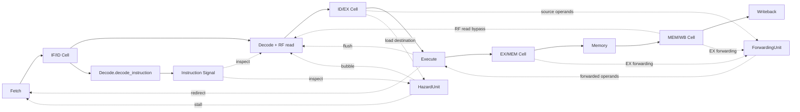

# Ripes RV5S 前端模型

这个示例用当前 ACPy → MLIR → C++ 编译链描述 Ripes 的标准五级 RV5S。
模型是静态硬件描述，Python 负责构造和编译；每拍行为由生成的 C++ 或通用 IR 解释器执行。

## 从哪里阅读

- [model.py](model.py)：五级流水线、寄存器堆、HazardUnit／ForwardingUnit，以及顶层连接。
- [demo.py](demo.py)：带汇编注释的指令程序和可直接编译的 Demo 顶层。
- [isa.py](isa.py)：级间 payload、指令译码、ALU、分支比较、前递选择。
- [verify.py](verify.py)：把机器指令、初始寄存器和数据编译成实例，与原生参考逐拍比较。
- [reference.json](reference.json)：9 个端到端指令程序及原生 Ripes 参考数据，含来源 commit 和校验和。

顶层声明 IF/ID、ID/EX、EX/MEM、MEM/WB 四个 Cell，以 Stage 的 return 绑定各级输出。
输入 Cell 直接观察拍初状态；return 返回下一拍的 payload，获准后写入左侧已有的 Cell，
不导出内部组件引用，不增加搬运事务或额外周期。

```python
instruction = decode_stage.inspect()
stall = hazard_unit.load_use(id_ex, instruction)
operands = forwarding_unit.resolve(id_ex, ex_mem, mem_wb)
result = execute.resolve(id_ex, operands)
control = Control(stall, result.redirect, result.target, operands.source_a, operands.source_b)

if_id = fetch(control)
id_ex = decode_stage(if_id, control, rf, mem_wb)
ex_mem = execute(result.packet)
mem_wb = memory(ex_mem)
writeback(mem_wb, rf, code_size)
```

Decode 内部声明 `instruction = ac.signal[Instruction]()`，由独立的 `decode_instruction` Rule
读取 IF/ID 并发布本拍译码结果。公开只读 `inspect()` 返回该 Signal 的值，供本级和 HazardUnit 使用。
译码发布不依赖 stall／redirect，即使本级停顿或冲刷也会执行，避免控制信号依赖自身的循环。
Signal 每拍先 invalid，再由生产者 set；编译器通过 set → get 关系把生产者排到消费者之前，
不增加流水周期。顶层通过查询接口连接结果，不直接调用译码算法，也不把结果传回 Decode。
HazardUnit 比较 ID/EX 的 load 目的寄存器与 IF/ID 的源寄存器，给出 load-use 停顿。
ForwardingUnit 选择 EX/MEM 或 MEM/WB 的前递值；Execute 只负责 ALU、分支和跳转计算。
这三个组件的查询都是只读组合计算，不增加状态或周期；顶层汇总控制信号，再调用各级更新 Rule。
Execute 的结果同时用于跳转控制与 EX/MEM 输出；普通 var 不跨状态修改事务传递。
Fetch 保留自己的 PC／ROM，RF 和 Memory 保留自己的存储表项；四个流水寄存器属于顶层。
寄存器堆和数据存储表项均为独立 Cell，外部访问通过所属 Module 的公开 Rule。



## 对齐的时序

| 行为 | 表达 |
| --- | --- |
| 级间寄存器 | Cell 读取旧值，拍末统一提交；一个环节一个 Module |
| EX 前递 | EX/MEM 优先于 MEM/WB；x0 不前递；store 数据与分支操作数同样经过前递 |
| WB→ID 旁路 | RF.read 显式选择当前 WB 值，不改变 Cell 的旧值读取语义 |
| load-use | 冻结 PC 和 IF/ID，清空 ID/EX；旧 EX 指令仍进入 MEM |
| 分支／跳转 | EX 决定目标，下一拍 PC 跳转，清空 IF/ID 和 ID/EX |
| 访存 | MEM 组合读、拍末写；没有可变延迟或 FIFO 反压 |
| 观测 | 保存本拍使用的 control、退休和 store 事件，不参与数据通路控制 |

Ripes 的级间结构是 enable／clear 寄存器，所以这里使用 Cell，没有人为加入 Queue 反压。
Fetch 停顿时返回 `None` 保持 IF/ID；Decode 插气泡、分支冲刷时返回对应的气泡 payload，明确写入 Cell。
不使用 scoreboard、WAW 停顿或保守写回互锁。气泡的 valid 是明确的流水线状态位，
不是临时 SSA var 的有效性。

首版 ISA：RV32I 整数寄存器／立即数运算、LUI／AUIPC、六种条件分支、JAL／JALR、LW／SW。
PC 从 0 开始；程序 ROM 容量 256 个 word，数据窗口为基址起的 64 个 word，访存要求 word 对齐。
程序和初始状态是静态构造参数，测试从机器指令开始执行，不直接向流水线注入已译码消息。

## 运行与结果

按仓库 README 构建并设置 `ACPY_MLIR_COMPILER`、`LD_LIBRARY_PATH` 后：

```bash
python -m pycircuit.examples.ripes5.verify
python -m pycircuit.examples.ripes5.verify --case load_branch_wrong_path --reload
python -m pycircuit compile pycircuit/examples/ripes5/demo.py --top Demo \
  --output pycircuit/builds/ripes5 --emit-cpp --cycles 25
```

9 个程序覆盖整数运算、前递优先级、WB→ID 旁路、store 数据、循环求和、分支／跳转、
load-use、错误路径 store 取消、JALR 前递、无伪 load-use，以及初始值和 x0。
比较的是每拍 PC、各级有效 PC、气泡标记、实际控制选择、全部寄存器和数据、退休及 store 事件。
额外比较生成的 C++ 与事务／RTL 友好 IR 的解释执行；没有生成 Verilog 或运行 RTL 仿真器。

当前 Signal 版本的编译和验证产物在 `pycircuit/builds/benchmarks/ripes5-signal/`。
增加一个独立译码发布事务，共 7 个事务。组件拆分及此前只读译码版本的历史验证分别在
`pycircuit/builds/benchmarks/ripes5-units/` 和 `pycircuit/builds/benchmarks/ripes5-decode/`。
可审阅的默认实例在 `pycircuit/builds/ripes5/`，默认选择 load／分支／错误路径程序。
其中的 IR 和 C++ 来自 `demo.py`；各 benchmark 目录的 `source.py` 展示参考输入如何连接到参数化的 Ripes5。

参考为之前保存的**原生 Ripes RV5S** 轨迹，原始文件位于
`reference/benchmarks/ripes5/acceptance/`；压缩后的参考随示例保存，不依赖旧 pyCircuit 模型。
本次没有重新运行原生 Ripes：现存 runner 的 Qt 动态库路径已失效。
`reference.json` 保存逐文件 SHA256、Ripes／VSRTL commit、原生二进制 SHA256。
寄存器和内存使用变化记录无损恢复参考快照；control 与产生本次更新的拍初决策比较。
参考的 `end_pc` 是 runner 的结束标记地址，不是代码区大小；代码区包括其后的终止循环和 NOP。

## 发现的问题与当前边界

| 问题 | 处理 |
| --- | --- |
| 嵌套条件内部分提前返回，可能被函数尾的默认返回覆盖 | 已修复前端返回路径合流，并加入独立预期回归；此前 C++／IR 一致也未发现这个共同错误 |
| struct 字段与 helper 同名时被错误地加上全局限定名 | 已修复字段的词法作用域；保留 `alu` 字段与同名 helper 验证 |
| 共享的带检查组合结果参与嵌套条件时，C++ 需求路径合并可能产生人为的排序环 | 改为保留原短路顺序的局部分支语句；仍使用共享计算边界，不改变 Rule 图或恢复逐 SSA 缓存 |
| 数组字面量传给 Module 构造函数时，没有按形参类型推导数组类型 | 当前按首版显式类型规范，先声明 typed array，再连接；推导能力仍待补充 |
| struct 字段不接受构造表达式作为默认值 | 当前使用已有的 struct 零初始化；非零嵌套默认值尚未扩展 |

尚未覆盖 ECALL 的流水线排空与宿主 syscall、CSR、M／C 扩展、byte／halfword 访存和非对齐目标。
JALR 目标按本地 RV5S 的 ALU→PC 连线处理，未另外加入低位清零；现有参考程序的目标均对齐。
这些是当前模型／参考覆盖范围，不声称实现完整 RV32I 系统或所有 Ripes 功能。
