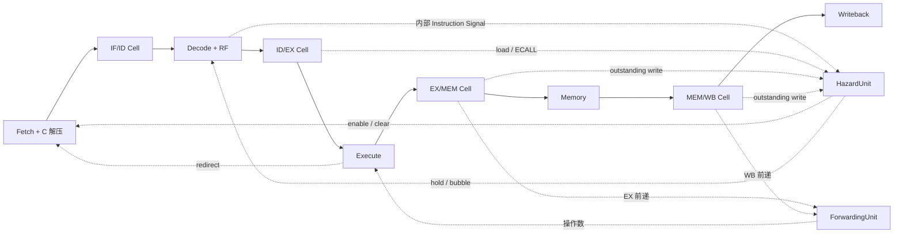

# RV32IMC 五级 CPU 与原生 Ripes RV5S 对照

> 本页保留实现与历史复现说明。当前统一入口和检查范围见[测试流程](../tests/README.md)及[标准化记录](standardization.md)。

> 当前实现尚未完成最终验收，已复现的问题见[审查报告](review-2026-10-15.md)。

模型由可编译 ACPy 描述，保留 Fetch／Decode／Execute／Memory／Writeback 五级 Module、
独立 HazardUnit／ForwardingUnit，以及 Decode 内部发布译码结果的 Signal。
指令语义遵循 RV32I、M、C；原生 Ripes 的已确认差异单独记录。

入口：

| 文件 | 内容 |
| --- | --- |
| [model.py](../model/model.py) | 五级流水、RF、内存、前递、冒险、ECALL 排空与事件 |
| [isa.py](../model/isa.py) | payload、严格译码、ALU、M 运算、纯组合 C 解压 |
| [program.py](../tests/program.py) | 校验过的统一机器码 byte 输入、ELF 段、入口、初始状态及 SHA256 |
| [native/runner.cpp](../tests/native/runner.cpp) | 原生 RV5S 观察与确定性运行环境，不改参考 CPU |
| [e2e.py](../tests/e2e.py) | 原生逐拍、C++、事务 IR、RTL 友好 IR、独立预期比较 |
| [oracle.py](../tests/oracle.py) | LLVM 反汇编驱动的独立顺序预期，无 ACPy 数据通路依赖 |
| [suite.py](../tests/suite.py) | 上游清单、算法和固定种子／边界程序 |
| [acceptance.py](../tests/acceptance.py) | 包含原有 9 个程序的完整验收入口 |
| [special.py](../tests/special.py) | 按规范检查，并保留参考缺陷／不支持证据 |
| [demo.py](../model/demo.py) | 可读的 load-use、分支、错误路径 store 程序 |
| [reference.json](../tests/fixtures/reference.json) | 原有 9 个程序的历史原生轨迹，供无 Qt 的编译器回归使用 |

## 结构和时序

四个流水寄存器属于顶层；各 Stage 的 return 在拍末写入绑定的 Cell，输入观察拍初旧值。
Decode 的 `decode_instruction()` 每拍发布内部 `Instruction` Signal，`inspect()` 只读查询。
发布不依赖 stall／redirect，避免控制环。Signal 的 set → get 关系决定同拍调度，无额外周期。



| 行为 | 模型 |
| --- | --- |
| 前递 | EX/MEM 优先于 MEM/WB；WB→ID 显式旁路；x0 不前递 |
| load-use | PC、IF/ID 保持，ID/EX 插气泡，旧 EX 继续进入 MEM |
| 分支／跳转 | EX 重定向，清空 IF/ID 和 ID/EX；JALR 清最低位 |
| ECALL | EX 等待 MEM／WB 的寄存器写使能排空；保持前端和 ID/EX，EX/MEM 插停顿气泡 |
| 环境事件 | 仅实际执行路径产生一次；退出／断点／非法指令阻止年轻指令执行，老指令继续提交 |
| 访存 | MEM 小端组合读、拍末写；byte／halfword 符号扩展、部分写、跨 word |
| M | 单个 EX 阶段组合运算；除零、MIN/-1 和向零截断均显式处理 |
| C | Fetch 纯组合展开，复用 32 位执行通路；保留 raw、expanded 和实际下一 PC，链接地址使用真实长度 |

RF 为 32 个独立 Cell；RAM 为一个保存固定 word 数组的 Cell，跨 word 更新在局部 payload 合并后一次提交。
Decode 不对非法编码提前断言，错误路径的非法指令可被正常冲刷。非法信息沿流水携带，EX 报告事件。

## 输入与运行环境

文本窗口 `[0,0x1000)`，RAM `[0x1000,0x2000)`，默认栈顶 `0x2000`。
数据读取可以访问文本常量；store 只能写 RAM。输入和实际访问均检查边界；ELF BSS 也检查容量。
取指允许 16／32 位混排、半字地址上的 32 位指令及跨 word 取指。

`ProgramImage` 保存文本 bytes、RAM、32 个初始寄存器、I／IM／IMC 配置、入口、结束 PC／退出条件、周期上限及 SHA256。
两个模型由同一个输入实例构造。编译输入不足窗口的部分确定初始化为零。

ECALL 使用 a7 编号、a0 参数：1 打印有符号整数、4 打印零结尾字节字符串、11 打印低 8 位字符、
10 退出（状态 0）、93 退出（状态 a0）。硬件模型产生结构化事件，验证运行环境按事件顺序恢复输出并检查状态。
未知调用产生不支持事件并停止。没有交互输入、文件、CSR、特权、浮点或其他扩展。
EBREAK／C.EBREAK 产生断点事件；非法编码产生非法指令事件。

## 复现

按仓库 README 构建原生编译器，并设置 `ACPY_MLIR_COMPILER`、`ACPY_MLIR_OPT`、`LD_LIBRARY_PATH`。
参考源码统一在 `reference/`，新构建和日志分别位于 `pycircuit/builds/`、`pycircuit/builds/benchmarks/`。
LLVM 的 Clang／LLD／objcopy／objdump 用于汇编与 freestanding C，没有 CPU 专用编译路径。

本机 Qt 恢复命令（使用本地 Conda 缓存）：

```bash
/home/lc/opt/miniforge3/bin/conda create -y --offline \
  -p "$PWD/pycircuit/builds/ripes-qt" qt6-main=6.8.3 qt6-charts \
  libgl-devel libglx-devel libopengl-devel
python -m pycircuit.examples.ripes5.tests.native.build
```

构建脚本检查 Ripes／VSRTL commit 和工作树干净状态；只在原生工程加入观察 runner，CPU 源码保持原样。
固定 commit、二进制／adapter SHA256 与完整配置命令保存在 `builds/ripes-native/provenance.json`。
依赖源码优先从 `reference/<依赖名>/` 获取；本机也可只读复用历史 `reference/builds/ripes-reference/_deps/`。

```bash
python -m pycircuit.examples.ripes5.tests.acceptance --jobs 2
ASAN_OPTIONS=detect_leaks=0 python -m pycircuit.examples.ripes5.tests.special
ASAN_OPTIONS=detect_leaks=0 python -m unittest discover -s pycircuit/tests -p 'test_*.py'
python -m pycircuit.examples.ripes5.tests.report
```

单独复现、阶段重载与 sanitizer：

```bash
python -m pycircuit.examples.ripes5.tests.suite --case m_extremes --sanitize
python -m pycircuit.examples.ripes5.tests.suite --case compressed_calls --reload
python -m pycircuit.examples.ripes5.tests.suite --prepare-only
python -m pycircuit.examples.ripes5.tests.verify --case load_branch_wrong_path
```

每个程序目录保留原始／适配汇编或 C、ELF、反汇编、统一输入、顺序预期、原生 JSONL、三层 MLIR、
C++ 和逐拍轨迹。首次不一致写入 `first-mismatch.json`，包含程序、周期、字段、状态和复现命令。
上游自检必须返回 42；算法分别核对 720、21、55、500、134，不能只凭两个实现一致判断正确。

## 证据与参考差异

见 [验收报告](rv32imc-report.md)、[指令覆盖表](instruction-coverage.md)、
[程序清单](program-manifest.json) 和 [上游纳入／排除清单](upstream-inventory.json)。
原有 9 个程序均重新采集原生轨迹；历史紧凑 fixture 保留，方便无需 Qt 的常规回归。

比较拍初控制与拍末状态，使用硬件原始 valid／PC，单独处理 `stageInfo()` 的退出后显示隐藏。
同时比较生成 C++、事务 IR 解释、RTL 友好 IR 解释；没有真正 RTL 仿真。

参考差异不会算作对齐通过：Ripes 的 JALR 最低位、零压缩编码的取指长度和 EBREAK 译码存在已确认差异；
C.EBREAK 与非法指令事件不受该参考执行环境支持。每项均有程序、源码与原生观测证据。
rvc 的精确差异保存在 [reference-differences.json](../tests/fixtures/reference-differences.json)，变化即失败，不自动新增忽略项。

上游 riscv-tests 的 BSD 许可证与 Ripes MIT 许可证保留在 [licenses/](../tests/licenses/)，
每个纳入测试的目录另保存未修改的上游源码、许可证和 SHA256；移植 rvc 的语法／布局调整单独列明。
